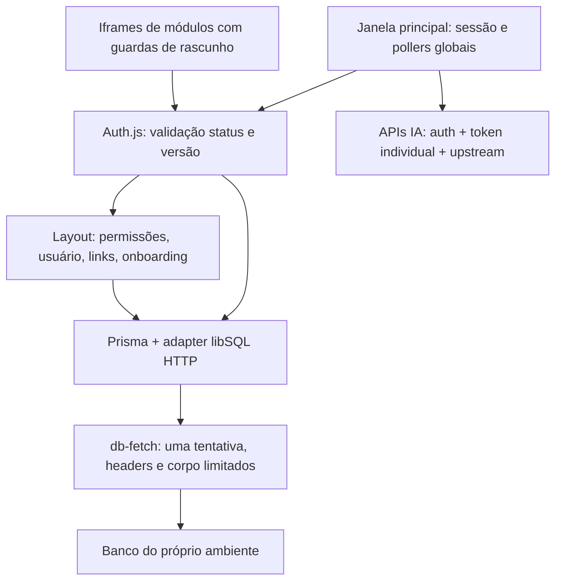

# Estabilidade do Painel Alpha — decisões de implementação

Data: 2026-10-26. Responsável: Aria / arquitetura. Base investigada: `ca156313eec5e484e3efe64d64abc477ab3fc769`, publicada nos dois ambientes durante o diagnóstico. Base efetiva do candidato: `20f310a345e04171fbe0b8e3e37f4ef0ce2e126f`, filho direto que preserva a correção concorrente de CRM/mês protocolar em12 arquivos sem schema. Escopo autorizado pelo usuário: melhorias do diagnóstico de lentidão/conexão, primeiro staging validado, depois produção. Blueprint: Scout, comunicação de26/10/2026; validação técnica dos budgets e desenho pelo lead Bibble. Este documento precede appcode. A story vinculada foi preparada SM/River e validada PO/Pax em sequência por instrução do lead.

## 1. Evidências, limites e objetivo

Fonte: [investigação de 26/10](../reports/investigacao-lentidao-conexao-2026-10-26.md). Houve 351 mensagens de deadline de transporte e 74 de autorização indisponível no deployment atual; categorias se sobrepõem. Uma sonda local `SELECT 1` concluiu em 5.502 ms; não mede p95 nem rede Vercel. Há tráfego de deployments anteriores e erros próprios de integrações IA. Não foi demonstrada causa única de rede, saturação, falha de Server Action ID ou necessidade de migration.

Objetivo verificável: aceitar leituras que concluem após 5 s dentro de limites finitos; reduzir trabalho recorrente redundante; conter falhas sem conceder acesso nem descartar trabalho; distinguir banco/auth/upstream/versão nos sinais operacionais. Não prometer cura de falha externa apenas por aumentar prazo.

Sem mudança de schema, dados em massa, credenciais, provedor, ACL, funcionalidades dos módulos, novos módulos ou dependências nesta entrega. Não importar os 48 arquivos divergentes de CRM/schema do remoto staging cegamente. DevOps preserva refs e resolve a publicação da base correta sem perder trabalho anterior.

## 2. Estado existente e fluxo preservado

`src/lib/db-fetch.ts` limita cada tentativa HTTP a 5 s; POST Hrana pode conter escrita. `src/lib/auth/acesso-painel.ts` observa por 5 s, admite até 8 leituras e segura a vaga até settlement real; usa React cache somente no render atual, uma repetição estrita de `findUnique`, e distingue PERMITIDO/NEGADO/INDISPONIVEL. `src/lib/painel-leituras-ssr.ts` admite 4 grupos por 5 s; todos os trabalhos iniciados precisam terminar antes de liberar vaga. Essas proteções permanecem.

O adapter serializa operações: medir SDK e transporte é possível; chamar a diferença de “tempo de mutex” sem instrumentação direta é incorreto. Observer expirar não cancela automaticamente a fila do SDK. Nunca liberar vaga apenas por `Promise.race` nem usar resultado tardio para autorizar pedido já recusado.

Heartbeat já é React Query, top-window, single query e backoff 20→60 s. Broadcast ainda usa intervalo 15 s em cada documento; notificações já têm consulta consolidada checklist/chamados e cursor. Notas têm salvamento/rascunhos e guardas de navegação existentes que devem ser reutilizados.

## 3. ADR: prazos configuráveis e finitos

Alternativas avaliadas:

| Opção | Benefício | Custo/risco | Decisão |
| --- | --- | --- | --- |
| A: conservar 5 s | menor retenção por tentativa | recusa leitura 5,5 s e mantém assimetria cliente/servidor | rejeitada |
| B: ampliar moderadamente todos os budgets, mantendo limites de admissão | atende demora evidenciada e mantém recuperação finita | segura vagas mais tempo; exige observabilidade e backoff | adotada |
| C: 60–300 s ou retry de todo POST | mascara algumas falhas curtas | fila/efeitos duplicados, espera prolongada, diagnóstico ruim | rejeitada |

[AUTO-DECISION] Como configurar sem criar novo framework? → módulo pequeno de configuração validada reutilizando convenção de env do projeto; defaults documentados abaixo. YAML da skill é orientação genérica: não adicionar parser/runtime YAML ao aplicativo para este hotfix. Nenhum valor secreto vai ao bundle.

| Configuração proposta | Default | Limites e relacionamento |
| --- | ---: | --- |
| `DB_ROUNDTRIP_TIMEOUT_MS` (server) | 10.000 ms | inteiro 1.000–12.000; uma tentativa, incluindo corpo |
| `AUTH_VALIDATION_BUDGET_MS` (server) | 12.000 ms | 3.000–15.000 e pelo menos DB + 1.000 |
| `PAINEL_SSR_READ_BUDGET_MS` (server) | 20.000 ms | 5.000–25.000 e pelo menos DB + 2.000 |
| prazo de consulta sessão/heartbeat no browser | 30.000 ms | 30.000–60.000; máximo auth15 + write12 + margem3 |
| handshake de frame `PAINEL_EMBED_READY_TIMEOUT_MS` | 45.000 ms | 45.000–90.000; máximo auth15 + SSR25 + margem5 |

Config server inválida, vazia, NaN ou fora dos limites usa default seguro e um aviso sanitizado por inicialização; relacionamentos corrigidos dentro dos máximos, nunca infinito. Não ler env server em componente client. Se houver override público de prazos, usar apenas `NEXT_PUBLIC_*` com validação independente; são parâmetros não secretos de build, exigem rebuild. Preferir manter defaults client30/frame45 e ajustes server dentro dos máximos nesta entrega.

Justificativa: transporte10 s é duas vezes o limite anterior e permite 5,5 s; auth12 dá margem a uma tentativa10 s e fila curta, SSR20 permite mais de um roundtrip sem pretender concluir três leituras serializadas de10 s. São defaults iniciais, não percentis medidos. Aumentar pool8/4 não está autorizado por evidência; manter limites.

`consultarSessao` mantém um orçamento TOTAL para csrf + session; não reiniciar prazo em cada etapa. Erro/abort de cliente nunca faz logout por si. Frame45 s termina em estado recuperável e conserva documento/rascunho; nada de reload/remount automático.

Retry: transporte zero. Auth conserva no máximo uma repetição da leitura `usuarios.findUnique`, apenas erro de transporte estritamente classificado, respeitando saldo e atraso50–75 ms; não iniciar tentativa quando orçamento terminou. O retry de alertas BPM pode reconhecer timeout tipado e cause-chain limitada; `code:23` sozinho não prova transporte (SQLite também usa códigos). Sem classificar todos os Prisma errors como transitórios, sem retry de transação/escrita.

## 4. Observabilidade segura

Echo instrumenta `db-fetch` sem SQL/URL/request body/token/identity: evento estruturado com componente, fase `headers|body|complete|abort`, `headersMs`, `bodyMs` quando disponível, `totalMs`, resultado allowlist (`ok|deadline|caller_abort|network_error|http_error`), status HTTP numérico e contagem local de transportes em voo. Erros de fetch antes de headers também geram sinal. Timer cobre consumo do corpo, cancelamento e limpeza de listeners como hoje.

Auth/SSR registram contadores de admissão/pending/limite, duração observada, duração real de SDK, `observerExpired` e resultado permitido/negado/indisponível sem ID do usuário. Labels de operação/modelo apenas enum/allowlist; nunca args, where, SQL ou raw Error. Instrumentação Prisma usa interface suportada do adapter/extension; não patch de node_modules. Se total SDK e transporte não puderem ser correlacionados honestamente, registrar separadamente. Não anunciar “fila medida” a partir de diferença não correlacionada.

Sempre sinalizar falha, saturação e observer expirado; amostrar sucesso normal de baixo volume e reduzir logs de falhas repetidas sem ocultar contadores. Recibo de staging/produção inclui janela e deployment, quantidade de eventos e duração com origem explícita. Não calcular percentis de três sondas nem somar mensagens como requests únicos. Usar correlação do runtime quando fornecida, sem expor cabeçalhos arbitrários. Payload público de erro não contém stack, endpoint privado, modelo de banco ou secrets.

## 5. Redução de trabalho recorrente sem perder alertas

Nova usa os mecanismos existentes, sem criar segundo scheduler global:

| Consumidor | Mudança | Contrato preservado |
| --- | --- | --- |
| Heartbeat | `enabled` exige sessão autorizada+principal, queryKey com identidade da sessão, abort na troca/logout; manter React Query sem retry automático de POST | base20 s, backoff atual até60 s; 401/403 só encerram após protocolo Auth.js confirmar; 503 pausa/revalida |
| Broadcast | só janela principal com sessão permitida; uma busca por vez; próximo timeout após settlement; AbortController/deadline; 15 s saudável visível, 60 s oculto; falha30→60→120→300 s | último broadcast, dismiss e prioridade mantidos; visibilidade/foco pode antecipar UMA leitura quando não houver outra |
| Notificações consolidadas | manter único poller e cursor, adicionar deadline/falha6→12→24→60 s visível, oculto mínimo30 s; respeitar `Retry-After` limitado a300 s | nunca resetar cursor/snapshot por 5xx; recuperar novos eventos sem duplicação |
| Lembretes pendentes | top-window+sessão+permissão+visibilidade, single-flight, catch em toda chamada e cleanup; manter5 min | action faz Pusher/updateMany: sem replay automático após erro; próximo ciclo normal continua, sem burst |

Para GETs, interpretar `Retry-After` delta ou HTTP-date, clamp1–300 s, respeitando piso do backoff calculado. Foco/reconnect não dispara rajada nem cancela espera explicitamente pedida pelo servidor. Troca de usuário zera estado/cache por identidade para não mostrar notificações de outra pessoa. Visibilidade normal só revalida uma vez. Desmontagem e iframe bloqueiam novos pollers.

[AUTO-DECISION] Reduzir heartbeat para60 s saudável? → não nesta entrega: `UsuariosOnline/page.tsx` define online como `ultimo_aviso >= agora-20s`. Aumentar cadência isolada falsearia presença; não adicionar cache positivo de auth nem suprimir update que mascara revogação. Redução de chamadas vem da admissão correta, ausência em iframes e backoff/anti-overlap dos demais consumidores. Server catch heartbeat traduz transporte temporário em503 seguro, sem raw Error.

## 6. Rejeições, RSC e estado local

Nova cobre TODOS os caminhos assíncronos dos componentes atingidos: efeito inicial, postMessage, leitura de nota/workspace, abrir/criar/ativar/fechar/reordenar e persistência de preferências; `void` não dispensa catch. Reutilizar toast/estado de indisponibilidade existente. Cancelamento por desmontagem não produz toast tardio.

Workspace: terminar hidratação antes de persistir; comparar preferências hidratadas com intenção local e só escrever alteração real, com debounce/coalescing de preferências. Uma escrita em voo por workspace, próxima intenção explícita pode ser coalescida antes do envio. Falha de escrita fica pendente/visível para decisão do usuário; não reenviar cegamente resultado desconhecido. Efeito inicial não deve dar upsert apenas porque componente montou. Resposta de sync antiga não sobrescreve edição/abas novas; usar geração/ordem de requisição e estado do usuário.

Preservar rascunhos existentes por usuário/nota, texto do editor, abas e estado local em5xx. Nunca informar “salvo” após exceção, limpar rascunho por timeout, resetar histórico ou fechar diálogo para mascarar falha. Reconsultar estado depois de erro é permitido quando estritamente leitura; reexecutar criação/mutação sem idempotência não é. ACL continua sendo validada no servidor para cada operação, inclusive leitura de workspace/nota.

`auth()` noargs mantém façade fail-closed; `authComEstadoAcesso()` permanece uso restrito a adaptadores explícitos. Não lançar indisponibilidade dentro callback JWT do Auth.js (pode apagar cookies), não restaurar public user de claims/cache quando estado é INDISPONIVEL. Negado confirmado continua revogação real. RSC/root/frames usam estados recuperáveis/guardas existentes, mantendo permissões e aliases de módulos.

## 7. Contratos das integrações IA

Falha de auth/banco antes de upstream continua `{ code: "AUTH_UNAVAILABLE", retryable: true }`, HTTP503, no-store e `Retry-After`; não renomear para IA offline. Rotas autenticadas preservam resposta de sucesso existente e adicionam erro público consistente `{ error: mensagemSegura, code, retryable }`; campos auxiliares compatíveis como `models: []` podem permanecer no erro, mas status nunca200 em falha.

| Origem | HTTP/código público | Comportamento |
| --- | --- | --- |
| Config de integração inválida/indisponível | 503 `AI_CONFIGURATION_UNAVAILABLE` | mensagem genérica; nenhuma URL/token; sem tentativa de adivinhar valor sensitive omitido |
| Conexão/health upstream falhou | 502 `AI_UPSTREAM_UNAVAILABLE` | retryable; logging do serviço por enum seguro |
| Prazo upstream | 504 `AI_UPSTREAM_TIMEOUT` | retryable; deadline finito |
| Upstream503/rate limit | 503/429 `AI_UPSTREAM_UNAVAILABLE`/`AI_RATE_LIMITED` | Retry-After limitado, no-store |
| Consulta DB de owner/token falhou | 503 `AI_METADATA_UNAVAILABLE` | separado de rede upstream; sem token global fallback |

Echo pode preservar códigos já existentes equivalentes quando necessário à compatibilidade; documentar mapeamento final e ajustar consumidores Nova juntos. Sem retornar raw upstream body. Onyx usa token individual e filtragem de owner existente, nunca credencial global para contornar falha. Combinar signal externo e timeout sem um sobrescrever outro; prazo de resposta JSON inclui corpo. Não aplicar limite de JSON30 s cegamente ao SSE/chat streaming de longa duração; preservar contrato de streaming e cancelamento.

Nova apresenta estado indisponível específico para models/agentes/voz sem apagar conversa nem pins. `useVoiceStatus` já tem cache/inflight/backoff60→300/RetryAfter e fallback nativo: estender minimamente. GET health pode recuperar; POST de geração/voz/chat não é repetido automaticamente após resultado desconhecido. Diagnóstico operacional usa caminhos autenticados autorizados, registra status+code público e origem; chaves present-but-sensitive não são tratadas como ausentes.

## 8. Geolocalização, fullscreen e versões antigas

Manter `Permissions-Policy: geolocation=()` e demais políticas. Antes de chamar geo em WeatherWidget/Sprite, consultar `document.permissionsPolicy` ou `featurePolicy` quando disponível; se bloqueado, retornar fallback sem invocar API nem ficar tentando. Se API de policy indisponível, manter postura compatível com política fixa do projeto e não pedir geo automaticamente; não detectar apenas existência de `navigator.geolocation`. Não relaxar headers/iframe allow para suprimir console. Fullscreen mantém `allow="autoplay; fullscreen"` e remove atributo redundante `allowFullScreen`.

Reutilizar `/api/health/version` (no-store/SHA40) para aviso de versão publicada diferente SOMENTE se há SHA local conhecido. Permitir endpoint em staging Vercel explicitamente identificado para validação; sem derivar ambiente de hostname/header do cliente. O SHA não dá autorização nem acesso a dados. Falha503 health não dispara recarga nem logout.

No principal, consulta de versão é leve, espaçada (5 min) e single-flight; pode piggyback na revalidação existente. Divergência mostra aviso não modal e ação manual. Nunca chamar `location.reload`, atualizar src/remount de frames ou limpar caches automaticamente. Ação de atualizar passa pelo protocolo existente de `usePainelFrameLeaveGuard`/guard-state, valida source/origin/frame identity, verifica drafts e solicita preservar/salvar trabalho conforme UI atual antes da navegação. Frame sem resposta é trabalho potencialmente pendente, não autorização para destruir. Se não houver preservação verificável, aviso orienta o usuário e não oferece bypass silencioso. Não afirmar que recarga corrige banco ou que erro Server Action ID foi comprovado.

## 9. Ownership e dependências de execução

| Owner | Arquivos/responsabilidade exclusivos |
| --- | --- |
| Echo/backend | `src/lib/db-fetch.ts`, `src/lib/prisma.ts`, `src/lib/painel-leituras-ssr.ts`, `src/lib/auth/acesso-painel.ts`, configuração server nova se necessária; `src/app/api/heartbeat/route.ts`; retry leitura BPM; API models/voice, Onyx agents/voice-status, `src/lib/onyx/client.ts`; version route; actions workspace só se contrato precisar |
| Nova/frontend | `src/lib/auth/cliente-sessao.ts`; Heartbeat/BroadcastBanner/NotificacaoFlutuante; useNotasLembretesPendentes; NotesGlobalTaskbar; BibbleChatLayout/useVoiceStatus/WeatherWidget/Sprite; `src/lib/onyx/browser.ts`; PainelLayoutClient e constante frame; helper público de polling/geo se realmente compartilhado |
| Forge/QA/Anubis/Probe | quality gates reais, regressões auth/ACL, testes assíncronos e integração menu/frames; não modificar appcode concorrente sem coordenação |
| DevOps | env efetivo/binding separado, refs e origem do artefato, deploy staging→validação→produção, logs/recibos/rollback código |
| Scribe/Kowalski | documentação final e journal após resultados reais |

Echo define configuração server, status/code públicos e contrato version antes de Nova integrar. Nova usa defaults públicos independentes sem importar módulo server-only. Dividir testes pelos caminhos correspondentes; arquivos compartilhados são coordenados pelo lead. Nenhum agente reverte alterações de outro.

## 10. Critérios de aceite e testes obrigatórios

1. Testes de relógio falso provam uma resposta/corpo em5.502 ms passando no novo default e outra após10 s abortando; não trocar default e deixar fixture de20 ms que só prova código espelhado. Testar headers lentos, body lento, signal pré-abortado/durante body, cancel, cleanup e contagem de fetch exatamente1 em falha de POST.
2. Auth: sucesso após5 s e antes12 s; expiração12 s fail-closed; late success não autoriza nem libera capacidade cedo; saturação8; retry só leitura/transiente com saldo; inativo/missing/version mismatch continua NEGADO; public user ausente durante INDISPONIVEL; SDK pendente mantém vaga real.
3. SSR: mais de5 s e menos20 s funciona; falha/expiração/saturação4; allSettled retém vaga de todos iniciados; onboarding não inicia depois de expirar. Frame45 e cliente30 não vencem antes do orçamento do servidor correspondente; csrf+session usam total único.
4. Polling: montar principal+3 frames resulta em somente1 poller global por canal, uma chamada em voo mesmo com foco/reconnect, troca de usuário cancela/esvazia estado anterior; manter cursor/dismiss/ausência de duplicatas; Retry-After e backoff; heartbeat20 e sem write replay.
5. Notes/workspace: efeito inicial hidratado não upserta sem mudança; rejeições simuladas de cada action sem unhandledrejection; rascunho/aba/intenção não perdidos; sync antigo não pisa estado novo; sucesso falso não exibido; erro desconhecido de write não repetido.
6. IA: auth503 distinto de metadata503/upstream502/504; models falha não retorna200; logs e payloads não contêm URLs/tokens; body stall abortado; abort externo propagado; streaming SSE continua aberto conforme contrato; token individual/owner ACL intactos; voz preserva fallback e backoff.
7. Geo bloqueada não chama getCurrentPosition; headers de segurança idênticos; fullscreen preservado. Nova versão não recarrega, não remonta frames, não descarta draft e health indisponível não encerra sessão. Clique manual passa por guardas de todos os frames.
8. Executar `npm run lint`, `npm run typecheck`, `npm test`, `npm run build`. Ampliar testes existentes listados no blueprint, especialmente auth/db-fetch/acesso/SSR/sessao/frame, BPM retry, notas salvamento, Bibble voice/Onyx e version-route. Não tocar snapshots irrelevantes para mascarar falha.

## 11. Validação ambiental e rollout

DevOps verifica ambiente efetivo ANTES de scripts; staging usa `.env.staging.local` para CLI. Nunca copiar env/dados/banco de produção a staging. Fazer build do candidato correto; registrar hash, deployment, fingerprints não reversíveis de bindings e horário em recibo fora de dados sensíveis. Nenhuma migration: se implementação descobrir necessidade estrutural, separar escopo e acionar Vault com backup verificado e confirmação específica conforme AGENTS.md.

Staging deve cobrir navegação principal+checklist+cadastro+calendário em frames, sessão válida/revogada/temporariamente indisponível, rascunho de nota com falha simulada segura e recuperação, broadcast/notificações, codes IA e versão. Falhas lentas são injetadas em testes/ambiente controlado de staging, nunca caos em produção. Comparar contagem de pollers e solicitações por documento antes/depois em janela equivalente; coleta real de duração inclui a origem. Regressão de ACL, perda de draft, replay de write ou slot liberado cedo impede promoção.

Depois de staging aprovado e recibo, publicar mesmo conteúdo em produção com bindings production preservados; usuário já solicitou ambos ambientes. Monitorar janela inicial documentada de10–15 min: 5xx e codes, eventos de deadline/admissão, traces de rotas atingidas, presença de requests de deployments antigos. Persistência de falha externa gera evidência correlacionável ao provedor e diagnóstico de upstream; não aumentar limites de novo sem dados.

Rollback é de código/config da própria entrega para artefato anterior verificado de cada ambiente; não restaura banco nem revoga credenciais. Não regredir auth fail-closed/rascunhos para fazer indicador ficar verde. Avisar usuários com versão antiga por fluxo manual controlado.

## 12. Revisão de arquitetura e handoff SM/PO

Escopo fullstack de correção, risco moderado por autenticação/transporte e por preservação de trabalho. Checklist arquitetural aplicado ao escopo: alinhamento/evidências, componentes/fluxo, configuração bounded, segurança, resiliência, observabilidade, ownership/testes e deploy/rollback cobertos. Stack e schema permanecem existentes; atualização de dependências e re-arquitetura não necessárias. Aprovação de execução não é comprovação de resultados: gates e staging ainda pendentes.

Riscos residuais: (1) fila interna do adapter além do observer; mitigar slots reais e medir, não cache de autorização; (2) writes de resultado desconhecido; não repetir; (3) alteração de erro HTTP quebrar consumidor silencioso; adaptar contratos/frontend juntos; (4) maior timeout reter recursos; clamps/pools/backoff e monitoramento; (5) reload destruir rascunhos; apenas fluxo manual com guardas. Forçar50–300 s, cache positivo auth e fallback global de token foram descartados.

Handoff formal: SM cria story nova `story-estabilidade-painel-conexao-20261026.md` (nome sugerido) vinculada a este documento e ao relatório; PO valida escopo/aceite. Não reabrir story anterior encerrada de BPM como se esta correção já estivesse entregue. Subtarefas separadas Echo/Nova, gates Forge/Probe/Anubis/Lens/Sage e recibos DevOps staging/produção; checklist e file list começam pendentes e são atualizados com resultados reais. Nenhum appcode/deploy/schema foi executado pelo arquiteto.
