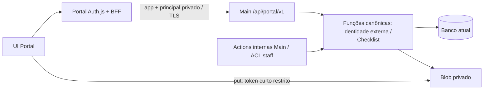

# API canônica Portal v1 — contrato normativo de implementação

Versão do desenho: **1.0, 23/10/2026, Aria**. Story `portal-api-canonica-20261023`, AC1–16. Freeze técnico concluído; revisão PO e implementação/gates/homologação continuam pendentes. As palavras DEVE/NÃO DEVE são requisitos desta entrega, derivados da story e dos fluxos existentes. O desenho não autoriza operação em banco real ou produção.

## 1. Decisão, limites e fontes

Criar `/api/portal/v1` no backend do Painel sobre o **banco atual**, com API allowlist e funções canônicas compartilhadas com as actions internas por chamada direta. Portal conserva UI/URLs e Auth.js Credentials como BFF; ao fim não possui Prisma, SQL, cópias de regras persistentes nem token master do Blob. Não criar banco, tabela, índice, migration, seed/backfill, outbox, novo email/OAuth, serviço pago ou registro privado. Separação física é decisão futura condicionada a métricas.

Base fresca: Main `274d6d6f`, Portal `e63fe49e`, worktrees `portal-api-20261023`; Scout `/tmp/portal-api-20261023-scout.md` e opmap30; Dara e parecer Aria de desacoplamento; arquitetura Checklist de22/10. Não refazer os320 models. SDK instalado: Blob2.8.2; Auth.js Portal beta31/@auth/core0.41.2; JOSE6.2.3 em ambas árvores; Zod Main4.4.3/Portal3.25.76. Detalhes de cookie/getToken abaixo foram conferidos no código instalado, não inferidos de documentação de outra versão.

Trade-off aceito: API acrescenta latência/disponibilidade de rede, enquanto reduz cópias de regras, privilégio e coordenação de schema. Não promete menor custo ou maior velocidade. Conta externa, atendimento e cadastro master continuam identidades distintas. Main permanece owner de master/CRM/staff e projeta somente os dados já necessários ao Portal.

## 2. Contrato editável e distribuição sem acoplamento ao schema

Fonte editável única no Main: `contracts/portal-api/v1.ts` (schemas/tipos/constantes/operações), `contracts/portal-api/sdk.server.ts` (transporte server-only) e `scripts/portal-api/generate-contract.mjs` (gerador). O contrato puro importa **`zod/v3`**, subpath disponível nas duas versões instaladas; não importa `zod`4 no wire, Prisma, serviços, Node, env ou server-only. A fonte Main pode continuar usando Zod4 internamente; erros Zod3 da fronteira devem ser tratados no guard próprio, sem depender de instanceof do Zod4 do resultado interno. Não atualizar globalmente Zod Portal nesta story. União de tipos de embasamento/status é literal pura.

Gerador determinístico copia fonte canônica/SDK para `artifacts/portal-api/v1/{v1.ts,sdk.server.ts,manifest.json}` Main; `--out <diretório>` exporta o mesmo conjunto para `Portal/lib/portal-api/generated/`. Usa filesystem local, sem registry ou dependência Git privada. Imports relativos do SDK apontam `./v1`; SDK inicia com `import 'server-only'`. Config/token não entram no código gerado. `--check` verifica bytes esperados sem escrever. Portal ganha `scripts/portal-api/check-contract.mjs` dependency-free para conferir SHA256 dos arquivos contra **seu próprio manifesto**, versão major e lista de arquivos; não exige paridade com a última revisão Main remota.

Manifesto: `contractVersion:'1.0.0'`, `major:1`, `sourceRevision` documental, `files:{'v1.ts':sha256,'sdk.server.ts':sha256}`, `operations:[{id,method,path,authMode}]`; sem timestamp variável e sem hash do schema Prisma. SHA é integridade/reprodução do artefato, não condição runtime de autorização ou exigência de redeploy para adição compatível. Header de resposta `X-Portal-Contract-Version:1.0.0` informa versão; SDK aceita major1 e ignora campos adicionais desconhecidos na resposta. Requests `.strict()` em todos objetos e objetos aninhados; responses por projeção allowlist no fornecedor e `.strip()`/tolerância aditiva no consumidor. Não usar `.strict()` em responses do SDK.

Adição opcional de campo/endpoint => minor e fornecedor continua aceitando requests antigos. Remoção/renomeação/tipo/semântica incompatível ou campo obrigatório novo => major novo, mantendo v1 durante migração. Não usar hash como handshake bloqueante. Teste fornecedor executa fixtures do consumidor v1 anterior (snapshot inicial congelado como baseline) e teste consumidor aceita campo extra; alterações internas CRM alheias não mudam o contrato/artefato.

## 3. Envelope, schemas e limites comuns

JSON UTF-8, Content-Type `application/json` para requests JSON. Sucesso sempre HTTP200 `{ok:true,data:T,requestId:UUID}`; erro `{ok:false,error:{code,message,fieldErrors?},requestId:UUID}`. `requestId` é criado no Main e propagado BFF; falha antes de receber envelope cria UUID no BFF. Não logar request/response body, headers de auth/cookies, token reset/recibo/principal, senha, hash ou stack/Prisma no retorno. Logs estruturados permitem requestId, operationId, status, duração e código público, sem identificador pessoal por padrão.

- `Id`: string trim1..80; `Revision`: inteiro seguro>=0; `Mutation`: UUID+expectedRevision; `Page`: page inteiro1..1.000.000 e pageSize1..100, default25 (notificações/documentos50). `checklistId/itemId/documentoId/empresaId` são IDs operacionais, nunca conta implícita.
- Tipos: RECEITA_BRUTA_DAS, RECEITA_BRUTA_CPRB, INICIO_RETOMADA, DISPONIBILIDADE_FINANCEIRA. Status item wire: os9 atuais mais FALAR_DR_EDVAN/FALAR_ANDREW de leitura legada. Nenhuma operação desta API permite editar status de item; preservar as9 escolhas existentes em constantes UI puras.
- Filtro empresas: page,pageSize,busca trim<=200,tipo opcional enum,status trim<=40,analistaId inteiropositivo,semAnalista boolean,clienteId inteiropositivo. ClienteId é filtro master combinado com a ACL da conta, nunca substitui ACL. Recusar parâmetros repetidos/desconhecidos, coerções ambíguas e corpo em GET; query boolean apenas `true|false`, números decimais inteiros canônicos; id path decodificado uma vez, sem barra/control characters.
- Documento list: empresaId obrigatório,itemId?,checklistId?,excluidos? boolean,page?,pageSize?; para PORTAL `excluidos:true` retorna lista vazia com mesma paginação, nunca revela removidos. Observação documental trim<=5000 ou null. Recibo/reset string32..100; nome upload trim1..180, MIME da allowlist atual de `documentos.ts` (`application/pdf`,`image/jpeg`,`image/png`), tamanho inteiro1..8.388.608. Nenhuma URL/storageKey arbitrária é input.
- Login `{email,senha}`: email trim/lowercase válido<=254; senha sem trim,1..4096 bytes UTF-8 para admitir legado>100 caracteres. Profile `{nome,email}`: nome trim2..100,email trim/lowercase válido<=254. Recovery email<=180 preserva a action. Password `{senhaAtual,novaSenha}`: atual1..4096bytes sem trim; nova>=12 caracteres conforme `string.min(12)` atual e<=72bytes UTF-8, sem normalização de senha. Reset `{token,novaSenha}` mesma policy nova. Bounded JSON admite senhas antigas longas sem usar policy nova no login.
- Corpo JSON máximo **32KiB reais**, independente de Content-Length e de config Server Actions; caminho+query máximo8KiB, cabeçalhos app/token bounded8KiB. Ler com contador antes de JSON.parse, cancelar ao exceder; recusar JSON truncado, gzip/Content-Encoding em request, Content-Type incompatível e `__proto__`/campos extras. Zod não substitui byte limit.
- Resposta JSON máximo **2MiB reais** no Main e SDK (inclusive corpo de erro). Main projeta/serializa de forma bounded antes de emitir; não devolver resposta parcial. Se detalhe legado exceder, erro LIMIT_EXCEEDED explícito, sem cortar itens silenciosamente nem inventar paginação nesta story. Array paginado<=100; histórico de checklist e itens do detalhe continuam atuais sob teto global. BFF não recebe arquivo como JSON/base64.

Erros públicos: UNAUTHENTICATED401 (inclui app inválido e principal inválido/revogado), FORBIDDEN403 (ação proibida em recurso próprio/CSRF), NOT_FOUND404, VALIDATION400, CONFLICT409, UPLOAD_INVALID400, LIMIT_EXCEEDED413, UNSUPPORTED_MEDIA415, RATE_LIMITED429+Retry-After1..3600, RETRYABLE503 (busy/rede/config/API indisponível), RETRYABLE504 (deadline), RETRYABLE502 (upstream malformado/redirect/protocolo), INTERNAL500. MODEL_EMPTY/MODEL_CODE_CONFLICT409 continuam se chegarem dos helpers, mas nenhum endpoint administrativo os expõe deliberadamente. GONE410 para compat aposentada. Método não permitido405+Allow. Endpoint não allowlisted404. Nunca converter erro em sucesso HTTP200 do wire; adapters das actions preservam Result ou `{error}` existentes.

Recursos inexistentes e de outra conta retornam **o mesmo NOT_FOUND404 genérico**, sem revelar ownership. Preflight API faz lookup autorizado antes dos helpers quando necessário e revalida transação; não muda globalmente a política das actions internas. Não enviar erro com existência/campo de cadastro de outra conta. Inbox marcar id alheio/inexistente mantém `{id}` com zero alterações, como hoje. Conflito de email no perfil tem mensagem estável existente e jamais inclui outra conta.

## 4. Matriz allowlist — todas as30 entradas Scout

Prefixo abaixo é `/api/portal/v1`. `A`=app autenticado sem principal (somente pré-sessão); `P`=app+principal verificado+revalidação de conta/versão. Nada deriva conta de query/body/header id. Nomes/métodos aqui estão congelados; não implementar dispatcher genérico por `operation`.

| # | Fluxo atual | Método/path Main ou destino local | Input adicional ao path / data de sucesso |
|---|---|---|---|
|1|Login|A POST `/identity/login`|email,senha → LoginPrivateDTO|
|2|Revalidar sessão|P GET `/identity/me`|sem query → IdentityDTO; nenhuma renovação|
|3|Logout|Local Auth.js `signOut`|limpa cookies locais; não cria endpoint ou revogação global|
|4|Solicitar recuperação|A POST `/identity/recovery`|email → `{message}` neutra atual, sem email/token|
|5|Consumir reset|A POST `/identity/reset`|token,novaSenha → `{reautenticar:true}`|
|6|Trocar senha|P POST `/identity/password`|senhaAtual,novaSenha → `{reautenticar:true}`; BFF adapta success:true e faz/manter signOut|
|7|Ler perfil|P GET `/profile`|sem query → ProfileDTO|
|8|Atualizar nome/email|P PATCH `/profile`|nome,email → `{success:true}`; revalidatePath local|
|9|Foto referência legada|Local `atualizarFoto`|guard privado /me, depois erro constante atual; URL nunca segue upstream|
|10|Avatar upload|P POST `/profile/avatar`|query filename1..255, MIMEheader+body binário<=2MiB → `{url}` relativa|
|11|Avatar download|P GET `/profile/avatar`|somente query v opcional hash20 → stream inline<=2MiB|
|12|Inbox paginada|P GET `/notifications`|page?,pageSize? → Page<NotificacaoDTO>+naoLidas|
|13|Marcar uma lida|P POST `/notifications/[id]/read`|corpo `{}` → `{id}`|
|14|Marcar todas lidas|P POST `/notifications/read-all`|`{}` → `{ok:true}` só conta atual|
|15|Incrementais legacy|P GET `/notifications/incremental`|desde ISO datetimeUTC → `{items:NotificacaoDTO[]}`<=100|
|16|SSE|P GET `/notifications/stream`|sem query → frames SSE existentes; regras seção8|
|17|Listar atendimentos|P GET `/atendimentos`|filtro empresas → Page<AtendimentoResumoDTO>|
|18|Detalhe ativo/histórico|P GET `/atendimentos/[id]`|checklistId? → AtendimentoDetalheDTO|
|19|Wrappers list/get|aliases locais|delegam17/18 via SDK; nenhuma query Portal|
|20|Progresso legacy|P GET `/checklists/[id]/progress`|owner resolve atendimento+ACL → ResumoDTO|
|21|Listar docs|P GET `/documents`|filtro documentos → Page<DocumentoDTO>|
|22|Iniciar upload direto|P POST `/uploads/initiate`|itemId,nome,mime,tamanhoBytes → UploadAutorizacaoDTO|
|23|Callback Blob|ausente|não criar rota/handleUpload; fluxo put+finalize permanece|
|24|Finalizar upload|P POST `/uploads/finalize`|itemId,recibo → UploadVerificadoDTO|
|25|Raw upload compat|Portal `/api/upload` POST retorna410|guard principal e CSRF antes; GONE, mensagem orienta envio atual; Main não ganha rota raw|
|26|Registrar doc|P POST `/documents`|itemId,recibo,mutationId,expectedRevision → DocumentoDTO|
|27|Observação doc|P PATCH `/documents/[id]/observation`|observacao,mutationId,expectedRevision → DocumentoDTO|
|28|Remover doc|P POST `/documents/[id]/remove`|mutationId,expectedRevision → DocumentoDTO; soft delete|
|29|Download doc|P GET `/documents/[id]/download`|sem query → attachment stream<=25MiB|
|30|UploadThing inativo|Portal `/api/uploadthing` GET/POST410|GONE constante sem provider/acesso a dados; retirar wrappers/deps mortos confirmados|

Raw8MiB não tem caller UI localizado e excede o limite de corpo da função Vercel; a opção410 é escolha deliberada compatibilizada nos AC10/12. Não passar arquivo por essa rota. Avatar2MiB continua binário BFF dentro do limite da plataforma. BFF preserva URLs `/api/checklist/upload/{iniciar,finalizar}`, `/api/checklist/documentos/[documentoId]/download`, `/api/perfil/avatar`, `/api/notificacoes`; chama os paths Main acima. Cada route/action tem guard próprio; middleware/proxy atuais excluem API. Sem endpoint público de health novo: READY é comprovado pelas probes app/login/me e operações autorizadas em staging.

## 5. DTOs explícitos wire — projeção, nunca retorno ORM inteiro

Datas são `new Date(...).toISOString()` UTC ou null; jamais Date/BigInt do ORM nem coerção automática de objeto inteiro. Objetos abaixo são schemas Zod3 explicitamente declarados e tipos inferidos desses schemas; os campos listados são o allowlist inicial. Opcional só quando assinalado `?`; null é diferente de ausência. `string` é texto bounded pelo teto de resposta, validado com limites próprios compatíveis com dados existentes, não HTML executável. IDs numéricos são inteiros seguros positivos.

- **LoginPrivateDTO** `{principalToken:string,principalExpiresAt:ISO,identity:IdentityDTO}`. Única resposta com principal; estritamente servidor-servidor, nunca devolvida da Server Action ou provider ao browser. **IdentityDTO** `{id:Id,nome:string,email:string,authSessionVersion:Revision,principalExpiresAt:ISO}`. /me não devolve token. **ProfileDTO** `{id:Id,nome:string,email:string,imagemUrl:string|null}`; imagemUrl só `/api/perfil/avatar?v=<hash20>` ou null, nunca chave/REF de storage.
- **CapacidadesDTO** booleanos explícitos `canRead,canEdit,canCreateOwn,canAssignOwner,canManageModels,canManagePortalAccess,canLinkCrm`. Projetar a partir de capacidades canônicas PORTAL, sem poderes administrativos. **ResumoDTO** `{estado:'SEM_CHECKLIST'|'SEM_ITENS'|'EM_ANDAMENTO'|'COMPLETO',total:int>=0,concluidos:int>=0,pendentes:int>=0,percentual:int0..100,semObrigatorios:boolean}`.
- **AnalistaDTO** `{id:number,nome:string,imagemUrl:string|null,status:string}` ou null. Conservar projeção existente do colaborador, sem role/email/permissões/hash; imagemUrl apenas URL de apresentação HTTPS já pública ou null (não retornar REF privada/caminho de storage). **MasterDTO** `{id:number,razaoSocial:string,nomeFantasia:string|null,cnpj:string,regimeTributario:string|null}`. Não incluir perfilCadastralJson nem demais campos CRM.
- **AtendimentoResumoDTO** `{id,clienteId:number,razaoSocial,cnpj,nomeFantasia:string|null,status:string,embasamento:string,mesProtocolo:string|null,linkGrupo:string|null,analista:AnalistaDTO,tipoAtivo:Tipo|null,checklistAtivoId:Id|null,resumo:ResumoDTO,revision:Revision,capabilities:CapacidadesDTO}`. Strings operacionais conservam semântica atual; linkGrupo é dado exibido, jamais URL upstream do SDK.
- **ChecklistReferenciaDTO** `{id:Id,tipo:Tipo,criadoEm:ISO,atualizadoEm:ISO}`. **ItemDTO** `{id,codigo,secao,descricao,complemento:string|null,status:StatusLeitura,observacao:string|null,obrigatorio:boolean,ordem:int,atualizadoEm:ISO,_count:{documentos:int>=0}}`. **AtendimentoDetalheDTO** `{id,clienteId:number,cliente:MasterDTO,analista:AnalistaDTO,tipoAtivo:Tipo|null,status,embasamento,mesProtocolo,linkGrupo,revision,checklistAtivoId,checklist:(ChecklistReferenciaDTO & {itens:ItemDTO[]})|null,checklists:ChecklistReferenciaDTO[],historical:boolean,resumo,capabilities}`; tipos dos campos repetidos iguais ao resumo. **Não há contaPortal** no wire PORTAL.
- **DocumentoDTO** `{id:Id,nome:string,url:string,uploadedByCliente:boolean,observacao:string|null,criadoEm:ISO,deletadoEm:ISO|null,deletadoPorCliente:boolean,uploadedByUsuarioId:number|null,uploadedByContaId:Id|null,deletadoPorUsuarioId:number|null,deletadoPorContaId:Id|null}`. Preservar campos de autoria já consumidos pela UI, sem joins cadastrais adicionais. URL exatamente `/api/checklist/documentos/<id-percent-encoded>/download`; não incluir storageProvider/storageAccess/storageKey/sha256/url legado.
- **NotificacaoDTO** `{id:Id,clienteId:Id,eventoId:Id|null,tipo:string,titulo:string,mensagem:string|null,empresaId:Id,itemId:Id|null,lida:boolean,criadaEm:ISO}`. clienteId é sempre o principal atual. **Page<T>** `{items:T[],totalCount:int>=0,page,pageSize}`; inbox acrescenta `naoLidas:int>=0`. Incremental `{items}`; SSE `{tipo:'novas_notificacoes',notificacoes:NotificacaoDTO[]}` mesma projeção.
- **UploadAutorizacaoDTO** `{recibo:string32..100,pathname:string,clientToken:string,access:'private',expiresAt:ISO}`; pathname/token são capacidade curta para um único upload, exceção funcional de exposição limitada. **UploadVerificadoDTO** `{recibo,nome,tamanhoBytes:int1..8388608,mimeType:Mime,verificado:true}`. A capacidade temporária nunca revela token read-write do store. SDK não pode tratar DTO desconhecido como `any`/cast de ReturnType.

Adapters locais preservam assinatura/forma das actions existentes: Checklist/segurança/notificações retornam Result; perfil get retorna `{data}` ou `{error}`, mutações `{success:true}` ou `{error}`. Não anexar LoginPrivateDTO, principal ou objeto JWT ao retorno de action/RSC. Datas string são aceitas por `new Date` atual. Tipos UI apontam schemas puros, não inferem serviço Main/Prisma.

## 6. App e principal: protocolo fechado sem nova tabela

**Configuração server-only, validada de forma lazy ao entrar no namespace:**

| Nome | Main | Portal | Regra |
|---|---|---|---|
|PORTAL_API_ENVIRONMENT|sim|sim|literal staging/local nesta entrega; produção requer futura autorização/configuração separada|
|PORTAL_API_ORIGIN|não|sim|origin exata Main, sem path/query/fragment/userinfo; HTTPS em staging; HTTP só localhost/127.0.0.1/[::1] em local|
|PORTAL_WEB_ORIGIN|sim|sim|origin exata Portal; mesma validação TLS; define CSRF/cookies, não Host recebido|
|PORTAL_API_APP_ID|não|sim|literal `painelclientes`|
|PORTAL_API_APP_KEY_ID|não|sim|kid ASCII regex `[A-Za-z0-9_-]{1,40}`|
|PORTAL_API_APP_KEY|não|sim|32bytes aleatórios base64url, específico staging; nunca NEXT_PUBLIC|
|PORTAL_API_APP_KEYS_JSON|sim|não|array de registros `{kid,appId,environment,key}`, appId painelclientes, máximo2 chaves por app/ambiente durante rotação|
|PORTAL_API_PRINCIPAL_KEYS_JSON|sim|**NÃO**|`{activeKid,keys:[{kid,secret}]}`, segredo HS25632bytes aleatórios base64url; máximo2 ativos durante rotação|
|AUTH_SECRET (ou NEXTAUTH_SECRET)|já existente staff|segredo **próprio Portal**|não compartilhar entre apps; Portal usa para JWE local, Main usa segredo API separado|

Missing/invalid config nova =>503 seguro **somente na API**, sem quebrar import/build/rotas internas Main ou tentar DB antes da guarda técnica. Carregar configuração/chaves somente server-side; validar claims/env contra configuração, não inferir staging de NODE_ENV ou aceitar env do request. Origem Main é configurada explicitamente (staging.alpha-comex.com em staging), endpoint path vem da allowlist; não usar URL/host enviado pelo browser. SDK `redirect:'manual'`, `cache:'no-store'`; qualquer3xx erro, sem seguir Location e sem reenviar segredos.

SDK envia `X-Portal-App-Id`, `X-Portal-App-Key-Id`, `X-Portal-App-Key` (nenhum forward vindo do browser), `Authorization: Bearer <principal>` só modoP. Main aceita app key apenas do registro no ambiente configurado, compara digest SHA256 em tempo constante e comprimento/formato bounded, nunca logs. Não aceitar query/api key/cookie Alpha como alternativa. Browser não conhece app key; sem CORS permissivo/Access-Control-Allow-Credentials. App sozinho só acessa três operaçõesA da matriz. Credencial técnica roubada não autoriza userId informado; login ainda exige senha válida, reset exige capability válida.

Após login bem-sucedido no owner, emitir JWS JOSE **HS256**, protected header exatamente `{alg:'HS256',typ:'portal-principal+jwt',kid}`. Secret assinatura fica **somente Main**; Portal não emite nem verifica com secret compartilhado, apenas guarda/transmite opaco. Claims mínimos: `iss='urn:alpha-comex:portal-api:<environment>'`, `aud='urn:alpha-comex:portal:<environment>'` string exata, `sub=ClienteOperacional.id`, `sv=authSessionVersion`, `azp='painelclientes'`, `env=environment`, `iat` NumericDate, `exp=iat+604800`, `jti=UUID`. Não colocar email/senha/role/capacidade INTERNO. Verificador permite apenas HS256/typ/kid conhecidos; recusa alg none/outra, jku/jwk/x5u/crit, claims ausentes/tipos errados, sub vazio, sv inválido, issuer/aud/env/azp incompatíveis, iat futuro>30s, exp ausente/expirado, lifetime diferente de7dias; tolerância relógio máxima30s.

Em **cada** chamadaP: verificar app, JWS e vinculação azp/env; consultar conta existente/sessionVersion e construir somente `{kind:'PORTAL',id:sub,sessionVersion:sv}`. Helpers canônicos continuam revalidando ownership e transações; nunca fabricar INTERNO nem confiar em userId/header. Principal revogado dá401 inclusive em `/identity/me`. Cookie Alpha sozinho sempre401. Não cachear revalidação de conta entre requests. Revalidação em stream seções8–9.

**Prazo/renovação escolhido:** principal absoluto7dias, igual à sessão atual Portal. **Não há refresh/exchange por ID nem endpoint de renovação** nesta fase. Auth.js pode renovar seu próprio envelope JWE, mas jamais estende `principalExpiresAt`: expiração absoluta força novo login. Isso evita protocolo extra e divergência entre renovação e revogação. Compensação do TTL longo: principal só no JWE HttpOnly, app separado, TLS, checagem de versão a cada operação e ausência de cache. Revogação por reset/troca incrementa versão; logout continua local, sem promessa de invalidar cópia roubada do cookie antes de expirar. Esse limite já existe no logout JWT atual.

Rotação: criar chaves novas no mesmo ambiente, Main aceita antiga+nova; trocar activeKid de assinatura sem distribuir segredo ao Portal. Guardar verificação da antiga até último token emitido nela+7dias+30s; remover antes apenas para revogação emergencial (força login). Para app key, Main aceita antiga+nova, Portal troca keyId/key, verificar requests e só então retirar antiga. Nenhum valor aparece no Git/manifesto/log. Mudanças de configuração são DevOps staging, não comandos deste desenho.

## 7. Auth.js privado, BFF, CSRF e pré-sessão

Config Portal explícita: `session.strategy='jwt'`, maxAge604800. Derivar `secureCookie` **somente do protocolo de PORTAL_WEB_ORIGIN validado**; definir `useSecureCookies` e `cookies.sessionToken` coerentes: HTTPS usa `__Secure.portal.authjs.session-token`; localHTTP usa `portal.authjs.session-token`; options `{httpOnly:true,secure:secureCookie,sameSite:'lax',path:'/'}` sem Domain. Nome próprio impede colisão com cookie staff. Cookie novo e ausência de principal em sessões legadas => login novamente no staging. Não migrar/exchange legado por userId. Auth.js gera/cifra/chunka e remove cookies via seu próprio mecanismo; não concatenar nem decifrar manualmente.

`Credentials.authorize(credentials,request)` chama transporte explícito `login` com app e IP observado, sem importar helper de sessão. Retorna User **privado** com id/nome/email/version, `portalPrincipalToken`, `portalPrincipalExpiresAt`; nunca senha/retorno inteiro. `jwt({token,user})` na emissão copia somente esses campos. Nas chamadas seguintes, se token privado ausente/expirado limpar id e campos privados; senão chama SDK explícito `/identity/me` passando **o principal recebido no argumento token**, sem `auth()` ou leitura de cookies. Erro401 ou qualquer falha de rede/protocolo => limpar id e principal; não deixar sessão válida por fallback/stale cache. Não aceitar campos privados vindos de `trigger:'update'`/session do browser. Pode atualizar nome/email a partir do /me, sem estender exp absoluto.

`session` callback é projeção explícita dos campos públicos atuais `user.id,nome,email,authSessionVersion` e expires; nunca spread token/User nem campo privado. Invalidar user quando id ausente. Assim `/api/auth/session`, SessionProvider, RSC e logs não recebem bearer. JWE criptografado trafega apenas como cookie HttpOnly; texto do principal jamais fica em localStorage, cookie legível por JS, URL ou DTO público. Headers de resposta pública e erro não o expõem.

**Recuperação exata do privado em Server Actions/BFF:** `lib/portal-api/session.server.ts`, `import 'server-only'`, usa `getToken` de `next-auth/jwt`. Construir `Headers` **apenas com cookie** da entrada (`request.headers.get('cookie')` na route ou `(await headers()).get('cookie')` na action/RSC). Passar `{req:{headers:cookieOnlyHeaders},secret:segredoPortal,cookieName:configuredName,salt:configuredName,secureCookie}`; `raw` omitido/false. Se segredo usar rotação, passar array na mesma ordem que encode/decode Auth.js. Não passar Authorization recebido: getToken instalado aceita fallback Bearer, que esta implementação deliberadamente impede. Não importar private lib @auth/core ou SessionStore. Cookie chunked é reconstituído pelo getToken oficial. Testar cookie simples e `.0/.1`, prefixo/salt, ilegível, truncado, expiração e bearer-in-header sem cookie.

Helper devolve somente estrutura privada tipada ao SDK servidor, verifica shape/data exp absoluta antes da chamada; identidade real ainda é verificada no Main em **cada operação**. Não chama `auth()`: elimina ciclo `auth -> SDK -> auth`. `auth()` público continua chamando nextAuth.auth(), cujo jwt callback revalida via transporte explícito, depois projeta Session. Módulos em camadas: contrato puro → transporte explícito sem auth → helper privado de cookies → adapters/actions; auth.ts usa só transporte explícito e config pública de cookie. Main signing secret não aparece em nenhuma camada Portal.

BFF/actions mutáveis (incluindo reset/recovery/avatar/iniciar/finalizar e compat raw) exigem `Origin` exatamente PORTAL_WEB_ORIGIN e recusam `Sec-Fetch-Site:cross-site`; não inferir origem de Host/X-Forwarded-Host. Em Server Actions conservar também validação de origem/proteções nativas do Next; guard explícito evita depender apenas da configuração. Requests browser mutáveis sem Origin falham403; SDK servidor para Main não envia Origin e é autorizado por app/principal. Login/signOut mantêm CSRF/callback da própria Auth.js e restringem callbackUrl/redirect ao origin Portal/path local. Rotas GET não mutam dados, recusam cross-site explícito, não dependem de Origin ausente em EventSource/img; guardP obrigatório. Não adicionar `allowedOrigins:*`, rota proxy genérica ou browser CORS para Main.

IP de autenticação: no Portal **Vercel** confiar somente `x-forwarded-for` sobrescrito pela plataforma (primeiro IP válido observado; conferir comportamento no preflight staging); ignorar cf-connecting-ip/x-real-ip e `X-Portal-Client-IP` recebidos de browser. Em local/teste sem proxy de confiança, usar bucket fixo `unavailable`, não confiar em headers arbitrários para burlar limite. SDK escreve `X-Portal-Client-IP` próprio, Main só o aceita depois de autenticar app e validar `isIP`, senão `unavailable`. IP é defesa de abuso, nunca identidade/ACL. Não aceitar IP em JSON ou query. [Vercel descreve a sobrescrita de X-Forwarded-For contra spoofing](https://vercel.com/docs/headers/request-headers).

Owner preserva políticas existentes: login IP30/15min e identificador5/15min (bloqueio15min); recovery IP20/h e identificador5/h (bloqueio1h), namespaces `portal:`/`portal-reset:` preservados. Login valida conta+senha, limpa bucket identificador após sucesso. Recovery conserva mensagem neutra mesmo limite identificador atingido; abuso por IP pode429; não consulta existência para alterar resposta. Reset hashSHA256, expiry15min emitida pelo analista no Main, update condicional single-use, limpa segredo/hash/expiração e incrementa versão; corrida/replay falha genericamente. Token continua em fragment URL e só body server-side; nunca query/referrer/log. Nada de email Resend staff.

Pré-sessão não usa nonce/banco novo: TLS+app authenticado, senha/capability verdadeira e rate limit são exigidos; capturar e repetir login não bypassa senha/limite nem dá principal de outro user. Reset é atômico single-use; recovery é neutro sem efeito de envio; login não é declarado single-use. Principais são bearer sujeitos à expiração/revogação e não uma prova antirreplay por request. Mutações documentais preservam mutationId/payloadHash/CAS no banco existente, sem dual-write; marcar inbox é idempotente. Não implementar cache de nonce em memória como se fosse proteção distribuída.

Credenciais externas: mover verificação Portal para owner `src/lib/portal-api/identity.ts`/helper externo dedicado; bcrypt-first; hash presente nunca fallback plaintext. Legado>72bytes usa comparaçãoSHA256 timing-safe sem upgrade truncado; <=72bytes pode CAS upgrade bcrypt12 de senhaHash:null/senha exata/versão e reconsulta em CAS perdido. Nova senha usa policy externa72bytes, não staff12–128; conta ausente/senha ruim retornam401 genérico. Troca valida senha atual e sessão válida, CAS **na versão do principal revalidado**, não versão nova arbitrária após corrida; reset/troca limpam token e incrementam authSessionVersion. Atualização nome/email revalida conta/versão dentro da transação antes de gravar, preservando unicidade; avatar e documentos mantêm as próprias revalidações/CAS. Funções internas emissão/criação de conta continuam mesmo owner transacional, não chamam HTTP nem policy/reset staff.

## 8. Arquivos e proxy streaming

Preservar fluxo existente iniciar→Blob `put` direto→finalizar→registrar; SDK2.8.2 `generateClientTokenFromReadWriteToken` com path exato, allowedContentTypes MIME exato, maximumSize8MiB, validUntil15min, sem sufixo/overwrite; acesso private no put. **Sem callback** nesta entrega. Finalize reautoriza conta/item, verifica recibo/expiração, bytes reais/length/MIME/magic/SHA e CAS antes de marcar verificado; registrar consome recibo no envelope transacional existente. Prefixo, storekey e `perfil-private:v1:` existentes permanecem; não regravar arquivos nem copiar storage de produção.

Main guarda credencial master e acesso aos objetos existentes do **ambiente staging**. Preservar binding atual: CHECKLIST_PRIVATE_BLOB_TOKEN e prefixo explícitos staging; fallback CHECKLIST_PRODUCTION_READ_WRITE_TOKEN continua condicionado estritamente ao ambiente de produção já definido em storage.ts e não é usado nesta iniciativa. Download legado só HTTPS+allowlist existente+redirect manual, sem URL arbitrária do caller. Portal depois não possui prefix/legacy hostlist/master-token; recebe apenas capacidade curta do upload direto.

Avatar upload <=2.097.152 bytes JPEG/PNG/WebP, corpo stream real, magic validada, gravação no Blob e atualização conta/version CAS preservadas; dono nunca deriva do filename. **Proxy binário BFF nunca faz arrayBuffer/blob/Buffer.concat do arquivo inteiro.** Owner pode manter bounded buffering de avatar2MiB e finalize8MiB onde já necessário à inspeção magic/SHA; não transformar isso em buffering do proxy/download, nem fingir transação Blob+DB. Erro entre storage e commit pode deixar objeto órfão como atualmente, sem prometer atomicidade distribuída.

Download doc<=26.214.400bytes e avatar<=2.097.152: Main autentica antes de abrir source, valida ACL/soft-delete e revalida principal exp/conta/version+ACL a cada5s durante stream (timer com cleanup, não só chegada de chunks). Pedido storage privado tem deadline10s; abort do caller cancela storage reader e timers. Timeout/ACL perdida após headers encerra stream com erro; antes dos headers usa envelope. Não retornar arquivo parcial como sucesso JSON, não retentar stream automaticamente e não usar fallback para URL pública. Não aceitar Range nesta fase (ignorar ou responder416 estável; escolha: **416**, sem abrir storage), pois contrato atual não o exige.

Limites/deadlines congelados: JSON Main20s/SDK25s; headers upstream10s; leitura storage10s; binário deadline total Main50s/BFF55s, idle10s; handlers de arquivo/SSE `runtime='nodejs'`, `dynamic='force-dynamic'`, `maxDuration=60`. Contagem bytes de entrada/saída independente de Content-Length; oversized header já conhecido rejeita cedo, contador real continua obrigatório. Excesso/cancel/erro cancela request/reader upstream. No BFF usar fetch duplex conforme runtime Node para request stream, AbortController combinando request.signal e deadline/idle, pipe com backpressure, sem clone/tee que bufferize. SDK JSON limitado igualmente e sem retries automáticos de mutações.

Somente encaminhar do Main ao browser: Content-Type permitido, Content-Disposition saneado, Content-Length somente se confiável e<=limite (pode omitir), Cache-Control privado/no-store, X-Content-Type-Options:nosniff, X-Request-Id; SSE acrescenta X-Accel-Buffering:no. Forçar política no BFF, não repassar qualquer header por cópia. Descartar Set-Cookie, Location, WWW-Authenticate, headers X-Portal/App/Authorization e metadados de storage; não enviar cookies de browser ao Main. Filename attachment remove CR/LF/control/path traversal e mantém nome exibido seguro. Errors upstream3xx/malformed/hyperlarge viram502/413 conforme seção3.

## 9. SSE inbox bounded

Main revalida token+conta/versão no início e a cada tick8s, consulta até100 não lidas asc(criadaEm,id), projeta NotificacaoDTO. Frames mantêm `data: {tipo:'novas_notificacoes',notificacoes:[...]}`+dupla quebra, UTF-8; enviar `retry:3000` inicial e comment heartbeat quando apropriado. Sem bearer no URL, cookie upstream ou event data. Sem claim de entrega exatamente uma vez; replay/duplicação seguem UI atual e listagem REST reconcilia inbox.

Stream Main termina normalmente aos **45s**, BFF aos **50s**, ambos maxDuration60. EventSource same-origin reconecta automaticamente após EOF; nova conexão passa getToken privado e Main guard de novo. Expiração absoluta do principal/versão inválida fecha stream; próxima conexão recebe401 e UI mantém comportamento de sessão inválida/relogin. Não renovar principal por SSE. Payload frame<=1MiB; stream total<=8MiB; exceder fecha com erro em vez de cortar JSON. BFF pipe bruto com contador, timeout inicial10s, idle20s (>tick8s), deadline50s, abort/backpressure; não parsear/guardar todo stream. Remover timers/listeners, abortar fetch e cancelar reader em cancel/request.abort/erro/revogação/fim. Testar reconexão e múltiplos cancelamentos idempotentes; não deixar timer vivo após desconexão.

## 10. Transações, retirada de código e provas

Ator PORTAL já existe. Adapters Main usam funções existentes `listarEmpresas/obterEmpresa/listarDocumentos/iniciarUploadDireto/finalizarUploadDireto/registrarDocumento/alterarDocumento`, mais identidade externa/perfil/notifs/avatar rehomed. Operações privadas de modelos/status/analista/CRM/criaratendimento/restaurar não aparecem no namespace. Antes dos helpers, normalizar input estrito e ID do path; nunca permitir body.documentoId divergente do path nem propagar campos extras administrativos.

Preservar recibo+documento+revisão+evento e ACL/replay/hash de payload na **mesma transação**. Same mutationId+payload/ator retorna efeito já obtido; diferente conflita; rollback em falha CAS não deixa doc/recibo parcialmente consumido. Não separar catálogo/revisões/auditoria ou escritores nesta fase. Main interno conserva sua autenticação/permissões e chamadas diretas. Não colocar HTTP no caminho staff apenas para reutilizar código.

Antes de remover backend Portal, rehome testes DB causais de credenciais/byte-limit/legado/reset/avatar/checklist/storage ao Main ou referenciar equivalência executada documentada. Retirar depois todos callers `auth.ts`, actions4, helper perfil e rotas arquivo/SSE, backend duplicado e imports transitivos. Converter módulos UI puros e tipos `TipoEmbasamento` para contrato, conservar apresentação atual. Remover Prisma/client/adapter/libsql/runtime sql deps, `lib/prisma.ts`, fonte schema/contrato hash/script/teste global; verificar postinstall/build/locks/fixtures. Não remover dumps/dados ou diretório inteiro cegamente. UploadThing/Pusher mortos saem após busca de callers; não reativar provider.

Matriz de provas necessária (sem executar DB real):

| Grupo | Evidência mínima |
|---|---|
|Principal/app|401 app ausente/ruim, principal forged/expired/alg/aud/iss/env/azp/kid/sub/sv inválidos, Alpha cookie sozinho, app sozinho+userId; revoked401; crossconta404 sem side effects; P nunca INTERNO|
|Sessão/BFF|cookie chunked/prefix/salt, Authorization sem cookie recusado, token legado login novamente, exp absoluto7d sem rolling refresh, jwt update não injeta campos, /me indisponível fail closed, sem recursão; Session/RSC/log/bundle sem principal/app/segredos|
|Contrato/HTTP|30 entradas cobertas, strict requests nested, response campo novo tolerado, DTO explicit/ISO/URLs BFF/sem secrets, hash integrity sem latest parity; respostas2MiB e requests32KiB sem Content-Length, query dup/truncation/media/redirect/upstream erros; CSRF e IP spoof|
|Identidade|bcrypt real Unicode72bytes/legado>100chars/hash-first/CAS concorrente; reset15min single-use/corrida/version e trocaCAS; recuperação neutra sem envio; nome/email normalize/conflito sem dados de terceiros|
|Transação|SQLite real descartável Main: replay igual/divergente, CAS rollback, receipt expired/consumed/conta errada/magic/SHA; doc+recibo+revision+journal uma transação, staff regressions|
|Binário/SSE|avatar2MiB/raw410/direct8MiB/doc25MiB, magic falso, revoked midstream5s, malformed/oversize/timeout/abort/backpressure/headers/legacy SSRF, SSE8s/45s+reconnect/cleanup; sem callback|
|Fronteira Portal|gates com DB/Turso/Blob master env ausentes, sem Prisma geração/deps/imports transitivos/scripts escondidos; fake API consumer valida BFF real; não trocar DB tests causais por fetch mock|

Quatro gates reais nos dois repositórios: lint/typecheck/test/build, contrato fornecedor-consumidor, depois Forge/Probe/Anubis/Lens/Sage conforme coordenação. SQLite apenas fixtures descartáveis sob controle dos testes; não executar migrações sobre DB remoto nem usar contas reais/seeds administrativos. API negative/positive integração deve chegar a guard/adapter reais; teste mock isolado não prova transação ou cookie.

## 11. Rollout staging, rollback e decisão PO

1. Implementar Main/contrato e provar localmente com fixtures; Portal atual ainda funciona pois banco/contrato antigo permanecem. Config nova é lazy: produção Main não depende dela sem publicação explícita.
2. DevOps confere destino efetivo staging e storage, credenciais próprias e TLS/origins, configura Main API **apenas custom staging** e publica Main. READY exige app guard negativo, login/me legítimo, contrato e operações owner autorizadas (sem conta administrativa/seed inventada), stream/storage e ambiente corretos. Não declarar READY apenas porque build passou/health200.
3. O usuário esclareceu em23/10 que todas as contas deste sistema são de teste e ainda não foram disponibilizadas a clientes. A homologação pode usar uma conta existente de staging, selecionada de forma privada/read-only pelo owner autorizado e exercitando CRUD/reset normais quando necessário; não exige criar fixture remota, seed, mass reset ou imprimir credenciais. Só então configurar app/origem/session Portal **staging** e publicar BFF. Cookies antigos pedem login novamente. Homologar UI e todas entradas pertinentes, incluindo criação/link/reset pelo analista existente, conta errada/revogação, upload/download/avatar e SSE real. Ausência de credencial legítima de teste limita homologação e deve ser registrada, sem fabricar acesso por ID.
4. Com provas completas, retirar dependência efetiva DB/Turso/Blob master do Portal **staging**. Cuidado obrigatório: custom environment Vercel pode herdar Preview com DB de produção; não apagar override e expor valor herdado. Verificar cada chave efetiva; se herança não puder ser removida no escopo staging, mascarar apenas custom staging com valor inerte vazio e provar que aplicação não a lê, ou bloquear a declaração “segredo retirado”. Não tocar Preview/global/Production para resolver isso. Não imprimir valores nem copiar env real.
5. Rollback Portal entre versões consumidoras compatíveis com API; Main mantém v1 e dados/handlers existentes durante transição. Não implementar fallback runtime para DB. Se for indispensável reativar deployment pré-API que precisa DB, tratar como rollback operacional explícito de versão/config staging pelo DevOps, fora do mecanismo automático e sem reintroduzir código SQL no BFF novo; preservar a evidência de que AC13/16 só vale para a versão nova. Não derrubar API antes de consumidores voltarem a versão compatível. Nenhum rollback toca banco nesta fase.

DDL/nova base/mass mutation não são necessários; se implementação descobrir necessidade real, separar relatório Vault+backup verificado<=48h+consentimento específico antes de executar e continuar trabalho independente. Remover schema Prisma **fonte** do Portal não é DDL nem altera banco; não pedir autorização de migração para mera retirada de arquivos. Produção continua fora do escopo desta autorização.

Este freeze resolve T0 e permite revisão PO curta seguida de Echo Main→Echo Portal sem nova decisão genérica de produto. Ajuste de implementação que preserve todas invariantes pode ser documentado; mudança de protocolo/TTL/ownership/novas operações/DB/produção volta ao arquiteto/coordenador antes de executar.

## Referências primárias e procedência

- [Auth.js session strategies](https://authjs.dev/concepts/session-strategies), [Credentials](https://authjs.dev/getting-started/authentication/credentials): contexto JWT/Credentials; API concreta getToken/cookies conferida em Portal `node_modules/@auth/core/{jwt.js,lib/utils/cookie.js}` e `next-auth/jwt` instalado.
- [Vercel Blob client upload](https://vercel.com/docs/vercel-blob/client-upload): upload direto; emissão concreta token+put sem callback conferida no SDK2.8.2 instalado e fontes atuais Scout, não transplantada de outro fluxo `handleUpload`.
- [Vercel request headers](https://vercel.com/docs/headers/request-headers): IP/proxy; conferir plataforma efetiva staging antes de confiar no header.
- Contrato comportamental local: Main `src/lib/checklist/{acesso,commands,documentos,service,leitura,items}.ts`; Portal `auth.ts`, actions de perfil/segurança/notificações/checklist e password-policy; schema somente como leitura para DTOs. Story canônica conserva o escopo/AC e registrará File List real de implementação.
