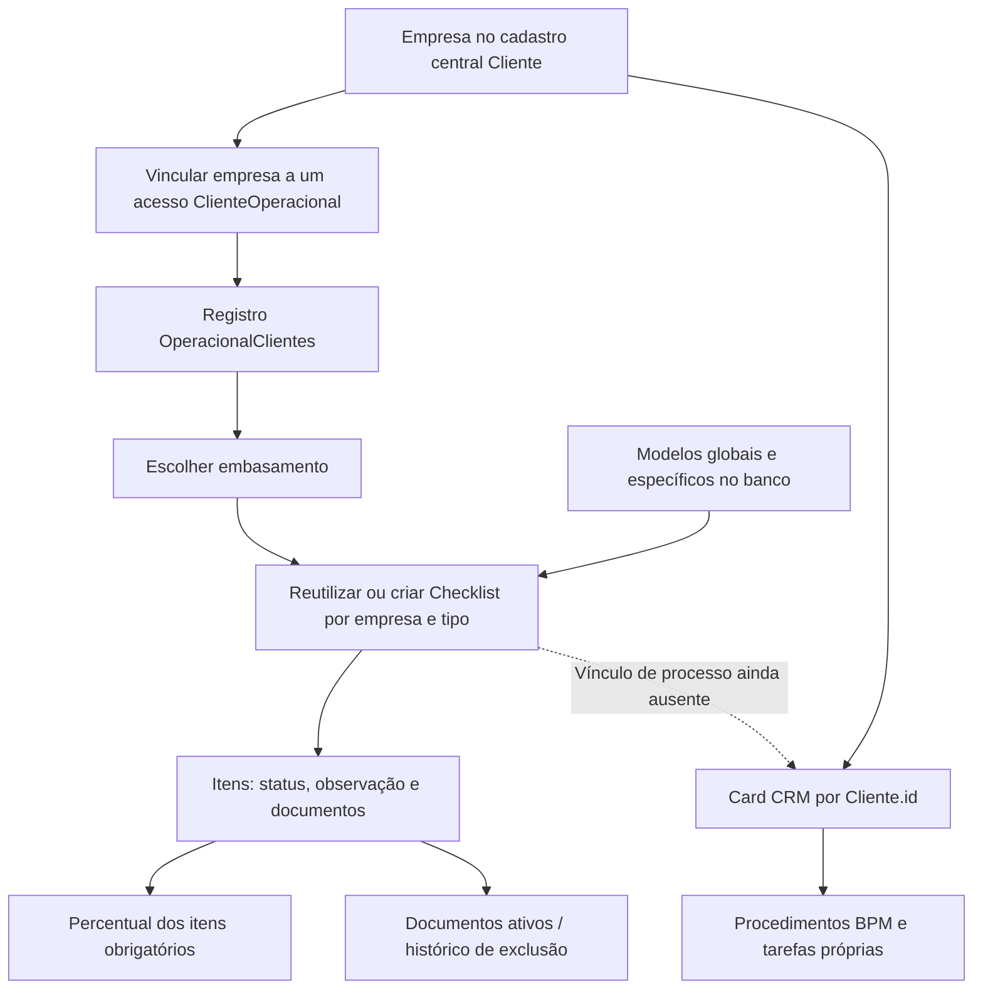

# Auditoria do Alpha CheckList e preparação para integração com o CRM

Data: 22/10/2026. Escopo: análise e propostas; nenhuma correção aplicada.

## Base e limites da análise

- Código auditado: `origin/staging`, commit `60ae49ffeb3711592337b63225934ccb88119543`, em worktree isolada `audit/checklist-20261022`.
- Em 22/10/2026 às 13:35 UTC, o alias de staging apontava para esse commit, com deployment READY. Produção apontava para `28651e7f4c6a3ed1be91f7437eb638638d047f0c`, também READY. Portanto, esta auditoria não afirma que o ambiente de produção inteiro seja idêntico ao staging.
- Comparação Git entre os dois commits: não houve diferenças no módulo `CheckList`, nas três actions, nas libs do checklist, no ZIP, hook/store/componentes próprios de notificação nem no `schema.prisma`. Entre os arquivos compartilhados examinados, `CentralNotificacoesPainel.tsx` difere. Isso sustenta a relevância dos defeitos do núcleo para a versão de produção citada, sem equiparar dados/configurações dos ambientes ou validar o portal externo.
- Alvo: módulo autônomo `/PainelAlpha/CheckList`, suas actions, catálogo, documentos, notificações e fronteira com o CRM. Os procedimentos BPM foram consultados para identificar diferenças e pontos de integração.
- Inspeção de código e testes isolados não equivalem a um teste autenticado no navegador. Não foram consultados registros reais nem executadas operações de cadastro, upload, exclusão, propagação de modelos ou migração nos ambientes publicados.
- A rastreabilidade abaixo refere-se aos caminhos e linhas do commit auditado. As evidências de preparação e versões estão em `/tmp/auditoria-checklist-20261022-preparation.json` e `/tmp/auditoria-checklist-20261022-releases.json`.

## Resultado

O módulo possui um fluxo documental próprio e compartilha o cadastro central de empresas com o CRM. Isso oferece um ponto de partida para a integração, mas ainda não existe um vínculo explícito entre o checklist autônomo e o processo/card do CRM. Há defeitos de gravação e divergências de progresso a corrigir antes de usar essas informações em automações.

## Como o módulo funciona hoje



1. **Cadastro:** o modal procura uma empresa já cadastrada no Cliente Master pelo CNPJ. O acesso do cliente e o vínculo operacional são registros separados. Se a empresa não existe, o fluxo orienta cadastrá-la no CRM; não cria um segundo cadastro central. Evidência: `src/app/PainelAlpha/CheckList/Modais/CadastroCliente.tsx:44`; `src/actions/ClientesOperacional.ts:47–120`.
2. **Criação:** ao escolher o embasamento, o sistema procura `(empresaId, tipo)`; reutiliza a instância ou cria checklist e itens. Existem quatro tipos: receita bruta DAS, receita bruta CPRB, início/retomada e disponibilidade financeira. Trocar o tipo preserva as instâncias dos outros tipos. Evidência: `src/actions/checklist.ts:207–248`, `:268–354`.
3. **Catálogo:** os itens vêm de `ModeloItemChecklist` no banco, incluindo modelos globais (`tipo` nulo) e modelos do embasamento. As constantes antigas de `CHECKLIST_TEMPLATES` não são o catálogo efetivo desse fluxo. Evidência: `src/actions/checklist.ts:207–223`; `src/lib/checklist/items.ts:257`.
4. **Acompanhamento:** há nove estados de item. O percentual considera apenas os obrigatórios; `OK` e `DESNECESSARIO` contam como completos. Sem obrigatórios, retorna 0%. Esse percentual não conclui automaticamente a empresa nem uma tarefa do CRM. Evidência: `src/lib/checklist/items.ts:333`; `src/actions/checklist.ts:365–463`.
5. **Documentos:** cada evidência pertence a um item. Existem leitura, observação, exclusão lógica e exportação ZIP. O histórico disponível é de arquivos excluídos, não uma trilha completa de alterações do checklist. Evidência: `src/actions/checklist.ts:475–613`.

### Situação por funcionalidade

“Implementado” nesta tabela significa que o encadeamento de código existe. A seção de testes informa o que foi efetivamente executado.

| Funcionalidade | Situação observada | Limite ou problema |
| --- | --- | --- |
| Cadastro vinculado ao Cliente Master | Fluxo implementado; evita criar outro cadastro central | Acesso e vínculo não formam uma operação atômica; verificar autorização e duplicidade |
| Pastas e organização das empresas | Rotas/actions e UI presentes | Não constituem vínculo com processo do CRM |
| Instanciar checklist por embasamento | Reutilização por empresa/tipo implementada | Pode criar checklist vazio se faltarem modelos |
| Preservar checklist anterior ao trocar tipo | Implementado | Lista, detalhe, percentual persistido e ZIP não usam o mesmo escopo |
| Alterar status e observação | Implementado | Alterar somente o status pode apagar a observação no banco |
| Percentual documental | Regra definida no helper | Campo persistido pode divergir da instância ativa; 100% não significa conclusão de tarefa |
| Modelos globais e específicos | Administração e propagação implementadas | Inserção altera instâncias existentes; atomicidade e política de aplicação precisam revisão |
| Editar, reordenar ou desativar modelo | Não disponível na UI ativa examinada | Capacidade ausente, não botão comprovadamente quebrado; evolução deve preservar instâncias anteriores |
| Histórico | Arquivos excluídos logicamente | Não registra autor/data/antes/depois de todas as mudanças do processo |
| Notificação de documento recebido | Consumidor Pusher presente | Produtor não localizado neste repositório; portal externo não auditado |
| Envio do checklist no CRM | Fluxo de anexo Excel existente | Não representa sincronização deste módulo autônomo |

## Fronteira entre CheckList e CRM

| Assunto | CheckList autônomo | CRM / BPM |
| --- | --- | --- |
| Identidade cadastral | `OperacionalClientes.clienteId → Cliente` | `BpmCard.empresaId → Cliente` |
| Unidade de acompanhamento | Registro operacional e checklist por embasamento | Card e instâncias de procedimentos |
| Itens | `Checklist`, `ItemChecklist`, `ModeloItemChecklist` | `BpmChecklist*`, `BpmCardChecklist*` |
| Estados | Nove estados e regra própria para obrigatoriedade | Pendente/concluído, responsáveis e tarefas derivadas |
| Evidências | `DocumentoChecklist` por item | Anexos/campos/documentos do card, conforme o fluxo |
| Conclusão | Percentual não fecha o processo automaticamente | Reconciliação própria com `BpmTarefa` |
| Vínculo entre os domínios | Não existe FK explícita card↔checklist autônomo | Compartilham somente a empresa cadastral |

Evidências: `prisma/schema.prisma:2063–2233`, `:5176–5206`, `:5360–5471`; `src/lib/bpm/checklists/reconciliacao-tarefa.ts:27`; `src/lib/bpm/checklist-envio-operacional.ts:3–22`.

O mesmo `Cliente` pode ter vários cards e vários registros `OperacionalClientes`. Portanto, buscar o primeiro registro pelo CNPJ ou `Cliente.id` não resolve qual atendimento deve receber o checklist. Também não é seguro converter automaticamente o percentual em conclusão de tarefa: os dois domínios usam critérios diferentes.

## Defeitos e riscos: o que mudar e como

Prioridades: **P1** = corrigir antes de ampliar o uso ou integrar ao CRM; **P2** = corrigir na estabilização do módulo; **P3** = limpeza e evolução. “Comprovado no código” indica a cadeia de implementação identificada, sem alegação de exploração remota ou ocorrência em dados reais. Impactos que dependem de falha, volume, concorrência ou consumidor externo estão expressamente condicionados.

Referências abreviadas a `ChecklistView.tsx`, `ListaChecklist.tsx`, `Modais/` e `Embasamentos/` pertencem a `src/app/PainelAlpha/CheckList/`.

### A01 — P1: verificações de acesso incompletas no servidor

**Evidência:** `src/actions/ClientesOperacional.ts:10–121` contém criação de acesso, consulta e vínculo sem guarda própria de autenticação/autorização. São funções importadas pelo modal ativo em `Modais/CadastroCliente.tsx:5`, `:44`, `:71`, `:100`. As demais actions verificam sessão, mas não a permissão configurável `checkList`: `src/actions/checklist.ts:47–50`; `src/actions/checklist-modelos.ts:33–35`. A rota ZIP também verifica apenas sessão (`src/app/api/checklist/[empresaId]/documentos/zip/route.ts:45–59`). O módulo está registrado com permissão em `src/lib/modulos-registry.ts:57`.

**Impacto:** esconder o menu ou revogar o módulo não estabelece a mesma restrição nas consultas e gravações. A administração de acessos de portal e modelos não possui autoridade específica nesta cadeia. Acesso global a empresas pode ser uma regra legítima para usuários autorizados; restrição por responsável não deve ser inventada pela auditoria.

**Como mudar:** aplicar uma guarda de servidor comum baseada na sessão ativa e nas permissões efetivas; reutilizar em página, action e ZIP. Definir separadamente quem opera checklist, administra modelos e vincula acesso de cliente. Quando houver escopo por empresa/processo, validá-lo no recurso antes da escrita ou do download.

**Como testar:** sessão ausente, módulo negado, permissão revogada, operador autorizado e administrador; negar antes de consultas de negócio/fetch. Acrescentar teste local do transporte Server Action. Não foi realizado ataque HTTP, obtenção de action IDs nem teste remoto de acesso anônimo; a ausência de guarda na função não é apresentada como exploração comprovada.

### A02 — P1: mudar somente o status apaga a observação

**Evidência:** `ChecklistView.tsx:150–152` envia `{ status }`; o backend aceita observação opcional, mas grava `observacao: parsed.observacao ?? null` em `src/actions/checklist.ts:359–378`.

**Gatilho e impacto:** um item com observação preenchida recebe alteração apenas no status. O campo omitido vira `null` no banco. A tela pode continuar exibindo o texto no estado local até ser recarregada, ocultando a perda (`ChecklistView.tsx:528`, `:632–636`).

**Como mudar:** implementar atualização parcial: campo ausente preserva o valor; observação explicitamente vazia segue a regra de limpeza. Retornar o estado persistido ao cliente.

**Como testar:** alteração só de status preserva texto; só de observação preserva status; limpeza explícita funciona; falha de gravação não apresenta sucesso nem deixa estado visual enganoso.

**Confirmação isolada pelo QA:** a action real, com sessão/Prisma/cache simulados, recebeu somente status e enviou `observacao: null` ao update do Prisma. Reproduz o defeito de contrato sem alterar dados reais.

### A03 — P1: credencial do portal persistida diretamente em texto

**Evidência:** `src/actions/ClientesOperacional.ts:25–30` grava `senha` diretamente. O modal gera/exibe senha com `Math.random` e seis caracteres (`CadastroCliente.tsx:184–185`); a validação permite quatro (`src/lib/validations/operacional.ts:15`).

**Impacto:** quem obtiver leitura da tabela ou de um backup poderá recuperar a credencial. O login consumidor de `ClienteOperacional` não foi localizado neste repositório; não se afirma que essa senha dê acesso ao painel interno.

**Como mudar:** primeiro identificar o contrato do portal externo; alterar ambos os lados para verificação por hash resistente com salt ou convite/reset com token expirável e geração criptográfica. Aplicar hash apenas no painel, sem adaptar o consumidor, pode interromper o acesso do cliente.

**Como testar:** segredo original ausente da persistência, login do portal compatível, convite expirado/reutilizado recusado. Eventual migração de credenciais exige planejamento próprio, Vault e autorização específica; nada foi migrado.

### A04 — P1: lista e resumo podem usar o checklist errado

**Evidência:** a lista usa `checklists[0]`, sem ordenar nem filtrar pelo tipo ativo (`src/actions/checklist.ts:76–109`). O detalhe prefere `empresa.tipo` e depois faz fallback ao primeiro (`ChecklistView.tsx:121–124`). Alterar item de uma instância antiga também pode sobrescrever o progresso geral da empresa (`checklist.ts:373–394`).

**Gatilho:** DAS a 100%, Disponibilidade a 0%; troca-se para Disponibilidade. O detalhe pode mostrar 0%, enquanto a listagem apresenta o primeiro checklist e 100%. A ausência de ordenação impede até depender de uma ordem fixa.

**Como mudar:** resolvedor único do checklist ativo, por empresa e tipo, usado em todas as projeções. Definir estado explícito para ausência de tipo/instância. Se o progresso continuar persistido, atualizá-lo transacionalmente e apenas para a instância ativa; caso contrário, derivá-lo do read model canônico.

**Como testar:** duas instâncias em ordens invertidas, troca de tipo, instância ausente, edição de checklist histórico e inserção de modelo obrigatório. O CRM só deve consumir esse resumo após a correção.

**Confirmação isolada pelo QA:** com instância histórica a 0% antes da ativa a 100%, `getEmpresasChecklist` real devolveu o ID da histórica e 0%. Prisma/autenticação foram simulados; não houve consulta de registros reais.

### A05 — P2: gravação parcial e notificações repetidas

**Evidência:** item, progresso e notificação são gravados em etapas separadas (`src/actions/checklist.ts:373–413`); a notificação não compara estado anterior e captura falhas silenciosamente. A observação é salva em todo blur (`ChecklistView.tsx:163–165`, `:636`).

**Impacto condicionado:** uma falha após salvar o item pode produzir erro apesar da alteração persistida. Repetir o comando pode duplicar aviso. Sem mudança real, o blur ainda gera notificação; concorrência pode deixar o resumo atrasado. Não houve simulação contra banco real.

**Como mudar:** transação para item e resumo, detecção de operação sem mudança, retorno do estado confirmado e estratégia explícita de conflito. Para avisos que precisam entrega confiável, reutilizar infraestrutura idempotente/eventos pós-commit ou avaliar outbox; não prometer entrega com `catch` vazio.

**Como testar:** falha entre gravações, reenvio do mesmo comando, observação inalterada, duas alterações simultâneas e erro de entrega da notificação.

### A06 — P2: criação de modelo pode deixar resultado parcial e códigos duplicados

**Evidência:** modelo criado antes da transação que propaga os itens (`src/actions/checklist-modelos.ts:82–118`). Não há unicidade de código por escopo no modelo; itens tampouco têm unicidade de código/modelo por checklist (`prisma/schema.prisma:2187–2217`). Se o código já existe, a propagação pode apenas trocar a referência do modelo sem atualizar sua descrição/seção/obrigatoriedade (`checklist-modelos.ts:99–102`).

**Impacto:** erro na propagação deixa o modelo criado; nova tentativa pode duplicá-lo. Instâncias antigas podem receber resultado diferente das novas. É uma consequência estrutural demonstrável; não se afirma haver duplicatas reais.

**Como mudar:** definir identidade do modelo e precedência global/específica; rejeitar colisões ou implementar override explícito. Publicação e materialização devem ser atômicas para lotes pequenos ou reconciliadas por processo idempotente para lotes maiores. Constraint eventual só depois de decidir a regra e tratar legados.

**Como testar:** falha no primeiro/último destino, retry, criação concorrente, mesmo código global/específico, comparação de instância antiga e nova.

### A07 — P2: adicionar modelo muda checklists existentes silenciosamente

**Evidência:** a UI anuncia itens para “próximos checklists” (`Embasamentos/EmbasamentosClient.tsx:20`), mas o servidor propaga para todas as instâncias do escopo, sem versão/filtro de conclusão e sem recalcular o resumo empresarial (`src/actions/checklist-modelos.ts:94–120`).

**Impacto:** novo item obrigatório pode reduzir a conclusão de um dossiê antes completo; o percentual persistido pode continuar antigo. A carga cresce com o número de checklists. Atualização retroativa pode ser desejada, mas não está descrita corretamente no fluxo.

**Como mudar:** escolha explícita entre “aplicar aos próximos” e “aplicar aos existentes”, com versão/snapshot, prévia de impacto e auditoria. Propagação existente precisa invalidar/recalcular as projeções. Qualquer aplicação em massa real fica sujeita a Vault, backup e autorização específica.

**Como testar:** instância completa, inativa, de outro tipo e nova; prévia/efeito coerentes; lote sintético grande; nenhuma atualização fora do escopo escolhido.

### A08 — P2: vínculo repetido cria acompanhamentos independentes

**Evidência:** `vincularEmpresaAoCliente` sempre executa `create`, após verificar somente existência de empresa e acesso (`src/actions/ClientesOperacional.ts:88–110`); o schema não define chave de ocorrência nem unicidade do par (`prisma/schema.prisma:2090–2123`).

**Impacto:** reenvio ou repetição do cadastro pode criar dois registros e dois conjuntos de checklists. Vários processos da mesma empresa podem ser legítimos; o modelo atual não identifica qual é qual.

**Como mudar:** decidir a unidade de acompanhamento e a cardinalidade. Se for um vínculo por empresa/acesso, criar comando idempotente protegido pela chave adequada. Se forem vários atendimentos, identificá-los explicitamente antes de ligar ao CRM. Não apagar duplicados presumidos.

**Como testar:** repetição sequencial/concorrente do mesmo comando, dois atendimentos legítimos e erro entre criar acesso e concluir vínculo.

### A09 — P2: ZIP pode perder arquivos com nomes iguais e exceder seu orçamento

**Evidência:** a entrada usa seção/código/nome (`src/app/api/checklist/[empresaId]/documentos/zip/route.ts:107–109`); dois arquivos do mesmo item com o mesmo nome geram o mesmo caminho, sobrescrito no ZIP. O corpo inteiro é lido antes da conferência real de tamanho (`:101–105`). Há até 100 downloads sequenciais com timeout individual de 20s, mas a rota dispõe de 60s (`:7–9`, `:83–105`).

**Impacto:** colisões podem omitir evidências; tamanho sem `Content-Length` confiável pode consumir memória antes de ser recusado. Volume e latência podem causar timeout. Carga pesada não foi executada. O ZIP também reúne documentos de todos os embasamentos, não apenas o ativo (`:55–67`); esse escopo precisa ficar explícito.

**Como mudar:** nomes únicos preservando extensão; streaming com limite real de bytes e deadline total; concorrência controlada ou exportação em lotes/job conforme volume. Oferecer claramente “ativo” ou “todos”, se ambos forem necessários.

**Como testar:** nomes iguais e colisões após sanitização, bytes acima do limite sem cabeçalho, vários atrasos, documentos antigos/ativos e conferência da quantidade final de entradas.

**Confirmação isolada pelo QA:** handler ZIP real e JSZip real, com autenticação/Prisma/fetch simulados: dois arquivos de mesmo nome resultaram em uma entrada, contendo apenas o segundo, sem aviso no LEIA-ME. Timeout, memória em carga e storage externo não foram testados.

### A10 — P2: origem e autorização documental precisam contrato verificável

**Evidência:** `adicionarDocumento` aceita URL genérica e origem informada no payload (`src/actions/checklist.ts:468–489`). Não foi localizado consumidor ativo dessa action. O ZIP valida HTTPS, alguns endereços locais e bloqueia redirect, mas não tem allowlist da origem de storage nem política completa de resolução/destino (`route.ts:23–38`, `:83–92`). A tela abre a URL documental diretamente (`ChecklistView.tsx:739–747`).

**Classificação:** risco condicionado a quem efetivamente grava URLs e às regras do storage/portal externo. Não foi comprovada exploração SSRF nem que os arquivos sejam públicos.

**Como mudar:** localizar o upload real e aceitar recibo/identificador de arquivo verificável do storage, vinculado à empresa/item e com autoria derivada no servidor. Revalidar acesso no download; se fetch externo for necessário, proteger destino e tamanho durante a leitura.

**Como testar:** origem legítima, URL de host estranho/local/IPv6/redirect, arquivo de outra empresa e autoria forjada, sempre em fixtures locais.

### A11 — P2: histórico não permite reconstruir o processo

**Evidência:** exclusão lógica grava data e se foi feita pelo cliente, sem usuário interno (`src/actions/checklist.ts:530–536`; `prisma/schema.prisma:2219–2231`). O histórico consulta apenas arquivos removidos (`checklist.ts:562–609`). Existe também exclusão definitiva exportada, sem consumidor ativo localizado (`:518–525`).

**Impacto:** não se identifica quem mudou status, observação, embasamento ou catálogo nem quem excluiu como analista. Não existe uma trilha suficiente para explicar ao CRM a evolução do dossiê.

**Como mudar:** eventos de negócio com ator da sessão, ação, recurso e data; antes/depois quando necessário, sem registrar conteúdo sensível desnecessário. Unificar a política de exclusão/arquivo e decidir retenção/restauração. Não excluir blobs ou dados nesta auditoria.

**Como testar:** autoria não forjável, repetição de exclusão não altera indevidamente o evento original, histórico preservado e retenção limitada ao escopo autorizado.

### A12 — P2/P3: leituras crescentes, catálogo truncado e estados vazios ambíguos

**Evidência:** listagem agrega todos os checklists/itens, detalhe também documentos removidos e histórico não é paginado (`src/actions/checklist.ts:68–195`, `:562–613`). O catálogo/resumo limita a 500 sem cursor/indicação (`src/actions/checklist-modelos.ts:45–49`, `:63–71`), enquanto a materialização consulta todos os modelos. A criação permite checklist vazio (`checklist.ts:207–237`).

**Impacto condicionado ao volume:** custo e payload crescem; administração pode ocultar modelos acima do limite embora ainda sejam usados. Checklist vazio ou sem obrigatórios fica a 0%, indistinto de pendência sem um estado próprio.

**Como mudar:** read model enxuto do checklist ativo, paginação/filtros no servidor, contagem por agregação, documentos removidos em consulta separada. Validar publicação do modelo antes de instanciar ou representar explicitamente “sem modelo/sem itens”. Unificar validações de CNPJ, enums, URLs e limites com os padrões centrais.

**Como testar:** mais de 500 modelos sintéticos, paginação estável, nenhum modelo publicado, apenas opcionais e crescimento de documentos. Não foi demonstrado N+1 de leitura; o problema identificado é volume agregado sem limites úteis.

### A13 — P1: trocar/criar checklist não substitui os itens na tela

**Evidência:** `ChecklistView.tsx:116–124` inicializa itens, seção e seleção com `useState`; os handlers de criação/troca apenas chamam `router.refresh()` (`:131–147`). A página `[empresaId]/page.tsx:33–39` não define chave por checklist. As novas props podem atualizar o título, enquanto a lista/progresso usa o estado anterior (`ChecklistView.tsx:193–199`, `:348`, `:432–443`).

**Gatilho e impacto:** criar a partir de vazio ou trocar de A para B na mesma rota, com preservação normal do componente pelo React. A tela pode ficar vazia ou exibir B com os itens de A; editar esses itens ainda envia seus IDs antigos e altera a instância anterior. Reabrir a tela pode mascarar o problema. Evidência estática, sem reprodução autenticada.

**Como mudar:** vincular estado à identidade/revisão da instância, reconciliando respostas persistidas e rascunhos. Uma chave por checklist permite reset deliberado quando apropriado; tratar rascunhos pendentes antes da troca. Não copiar props a cada render apagando texto em edição.

**Como testar:** vazio→criação, A→B→A com itens distintos, seção inexistente no novo tipo, observação pendente e IDs enviados após cada troca.

### A14 — P1: a tela ignora erros retornados e pode simular sucesso

**Evidência:** status usa `.catch` para rollback, mas a action captura falhas e resolve `{error}` (`ChecklistView.tsx:150–164`; `src/actions/checklist.ts:418–419`). Observações não verificam resultado; a exclusão oculta o documento após `await`, mesmo se o retorno for erro (`ChecklistView.tsx:694–703`). Criar/trocar e criar pasta também ignoram erros resolvidos. Contadores não são reconciliados quando o componente apenas esconde o documento.

**Impacto:** usuário acredita ter salvo status/observação ou excluído documento quando o banco recusou. Rejeições reais de rede podem deixar algumas operações em loading; o rollback existente pode usar um snapshot anterior ao último estado confirmado.

**Como mudar:** contrato único de resultado; tratar tanto `{error}` quanto rejeição de transporte, com `finally`, feedback e estado confirmado. Alterar lista/contadores apenas após sucesso ou aplicar rollback do último estado persistido. Serializar alterações por item ou validar revisão em respostas fora de ordem.

**Como testar:** erro resolvido e Promise rejeitada em cada comando, estado visual sem falso sucesso, exclusão falha mantendo arquivo, exclusão válida atualizando contagem e respostas concorrentes invertidas.

### A15 — P2: cadastro pode reutilizar consulta e acesso anteriores

**Evidência:** consultar CNPJ marca `consultado=true`; alterar o input não invalida a empresa consultada (`Modais/CadastroCliente.tsx:44–56`, `:140–141`). Finalizar envia o CNPJ atual com base nesse boolean (`:91–103`). Fechar o modal não reinicia seus estados, e ele permanece montado (`:118`; `ListaChecklist.tsx:255–259`).

**Impacto:** consultar empresa A e digitar B pode vincular B com o resumo visual ainda de A, caso B também exista no master. Reabrir pode reutilizar conta/seleção anteriores e favorecer vínculo repetido. O servidor relê a existência da empresa, portanto não se afirma que crie uma empresa inexistente.

**Como mudar:** seleção confirmada por ID/CNPJ consultado, invalidada ao editar; descartar respostas de consulta obsoletas. Reiniciar o wizard em novo cadastro ou oferecer retomada explícita quando a conta já tiver sido criada e o vínculo falhar.

**Como testar:** A→digitar B→finalizar exige nova consulta; consultas fora de ordem, fechar/reabrir, cancelamento e retry após criar conta sem concluir vínculo.

### A16 — P2: assinatura de notificação duplicada e leitura inconsistente

**Evidência:** o shell chama `useChecklistNotifications` (`src/components/layout/PainelLayoutClient.tsx:136`) e o widget montado no módulo chama o mesmo hook (`ListaChecklist.tsx:124`; `ChecklistView.tsx:208–209`; `src/components/Checklist/ChecklistNotificacoesWidget.tsx:10–12`). A proteção por ref é local à instância; cleanup remove evento/canal compartilhado (`src/hooks/useChecklistNotifications.ts:25–60`). O store limita a 50, mas o toast observa só o tamanho da lista (`src/store/useChecklistNotificacoes.ts:24–29`; `src/components/Checklist/ChecklistNotificationToast.tsx:17–27`).

**Impacto condicionado à chegada de evento:** dois avisos/sons para uma publicação; desmontar o widget pode interromper o assinante do shell. Com 50 itens, novos eventos mantêm o mesmo tamanho e podem não disparar toast. O clique do toast navega sem marcar leitura, enquanto a central usa outro caminho. O produtor externo não foi validado.

**Como mudar:** assinatura única no shell e widgets apenas consumidores; deduplicar por ID estável, observar o último evento e unificar marcação de leitura/navegação. Se houver múltiplos assinantes, cleanup por callback e gestão compartilhada de assinatura.

**Como testar:** shell+lista recebem um evento e geram um aviso; desmontagem preserva o shell; eventos 51 e 52 aparecem; replay não duplica; clique marca o aviso correto.

### A17 — P2: erro de consulta vira tela vazia; histórico de tipo exige reativação

**Evidência:** lista, histórico e catálogo convertem resultado sem dados em array vazio, sem diferenciar erro (`src/app/PainelAlpha/CheckList/page.tsx:23–29`; `Historico/page.tsx:10–13`; `Embasamentos/[tipo]/page.tsx:19–20`). A tela do detalhe trata o erro inicial, mas não orienta bem checklist existente sem itens. Para consultar outro tipo, o controle disponível aplica uma troca do tipo ativo (`ChecklistView.tsx:257–284`); `/Historico` mostra somente removidos. O rótulo de excluído pelo cliente também aparece em documentos removidos pelo analista (`:667`).

**Como mudar:** estados distintos para falha, ausência real, filtro sem resultado, sem checklist e sem modelo. Disponibilizar consulta histórica sem mudar o ativo, respeitando permissão de leitura/escrita, e rotular origem de exclusão corretamente. Explicitar escopo do ZIP junto ao botão.

**Como testar:** erro de DB/sessão não aparenta ausência de empresas; retry preserva filtros; consultar tipo anterior não altera ativo/progresso; exclusões do cliente e do analista têm rótulos corretos.

## Funções repetidas e código candidato a limpeza

| Repetição/candidato | Evidência e diferença | Como tratar |
| --- | --- | --- |
| Criar, trocar embasamento e editar empresa | `checklist.ts:225–249`, `:268–323`, `:325–355` repetem buscar/criar instância e selecionar tipo | Um serviço transacional comum; manter comandos públicos distintos quando expressarem intenções diferentes |
| Progresso em helper e action | `lib/checklist/items.ts:333` e `actions/checklist.ts:425–464` repetem critério | Um cálculo puro retornando geral e por seção; remover export sem uso somente após confirmar consumidores |
| Tipos/status em várias listas | `checklist.ts:199`, `lib/checklist/modelos.ts:4–9`, enum Prisma e listas UI | Fonte única para validação/labels, evitando divergência em novo tipo |
| Catálogo hardcoded e catálogo do banco | `CHECKLIST_TEMPLATES`, `lib/checklist/items.ts:257–286`, não é usado pela criação atual | Confirmar sementes/consumidores externos; retirar ou identificar claramente como legado; não ativar fallback silencioso |
| Componentes anteriores de lista/embasamento | `ListaClientesOperacional.tsx` e `Embasamentos/{EmbasamentoDAS,EmbasamentoRetomada,EmbasamentoDisFinanc}.tsx` sem importadores em `src` localizados | Validar referências de build e remover em entrega de limpeza com regressões |
| Exclusão definitiva e lógica | `removerDocumento` versus `excluirDocumentoAnalista` | Estabelecer política única e descontinuar caminho incompatível; não apagar evidências reais |
| Actions sem consumidor ativo encontrado | `adicionarDocumento`, `removerDocumento`, `verificarCnpjsOperacional`, `calcularProgresso` | Inventariar transporte/build e portal antes de remover; ausência de import não prova endpoint remoto acessível |
| CheckList e procedimentos BPM | Domínios, estados, documentos e tarefas distintos | Não tratar como duplicação removível; compartilhar padrões técnicos e integração explícita, preservando responsabilidades |

## Notificações e dependências externas

Há dois sentidos diferentes de comunicação:

- **Painel → cliente:** `atualizarItemChecklist` grava `NotificacaoCliente` em `src/actions/checklist.ts:404–413`.
- **Cliente → painel:** `src/hooks/useChecklistNotifications.ts` consome `private-checklist-docs` / `novo-documento-cliente`. Não foi localizado produtor desse evento em `src`, `scripts` ou `tests`; ele pode estar no portal externo. Sua ausência neste repositório não demonstra falha em produção.

O store local usa identidade baseada em tempo/documento, sem persistência durável de leitura ou recuperação de eventos desconectados. Isso deve ser avaliado junto ao portal e à central do painel antes de prometer entrega, deduplicação ou histórico de leitura. Também é necessário documentar quem autentica os acessos `ClienteOperacional`, de onde vêm os uploads e quais permissões o storage realmente aplica.

## Tratamento de erros e observabilidade

As actions misturam retornos de erro e exceções; algumas devolvem a mensagem técnica diretamente e a criação de notificação silencia falhas. Padronizar o contrato com códigos para acesso negado, validação, conflito e falha técnica; consumir esse contrato em todos os componentes, registrar erro sanitizado com identificador de correlação e devolver estado persistido. Um erro após gravação parcial precisa informar o estado real para evitar repetição do comando.

Como melhoria P3 de interface, reutilizar o componente Dialog e os labels do design system no cadastro, tratar foco/teclado e dar nome acessível a botões de ícone e selects. Evidência de ausência no código: `Modais/CadastroCliente.tsx:121–126`, `ChecklistView.tsx:587`, `ListaChecklist.tsx:273–281`. Não houve auditoria visual mobile ou com leitor de tela; não se afirma conformidade ou reprovação completa de acessibilidade.

## Como integrar ao CRM — proposta do Architect

Esta é uma recomendação para a próxima entrega, não uma arquitetura implementada ou uma nova regra de negócio aprovada.

### Alternativas

| Alternativa | O que entrega | Limite/custo |
| --- | --- | --- |
| A — acesso contextual | O card apresenta registros operacionais da mesma empresa e abre o escolhido | Entrega acesso rápido, mas não estabelece qual dossiê pertence à negociação; insuficiente para automação confiável |
| **B — vínculo explícito e projeção de leitura, recomendada** | Card associado ao registro operacional/instância acordado; resumo e pendências vêm do mesmo serviço do CheckList; documentos permanecem na origem | Requer definir cardinalidade, permissões e efeito da troca de embasamento; armazenamento do vínculo pode exigir alteração de schema posterior |
| C — espelhar em procedimentos BPM | Copiar itens para a estrutura de procedimentos existente | Exige conciliar estados/regras diferentes, duas cópias editáveis, conflitos e duplicação documental/tarefas; somente considerar por requisito explícito |

**Por que B:** conserva a autoridade documental, permite conferência consistente entre lista, detalhe e card, e reduz a necessidade de reconciliação entre cópias. Pode começar com leitura/navegação e ganhar automações depois. Não requer criar outro menu de checklist nem renomear os procedimentos BPM existentes.

### Contrato mínimo recomendado

- **Identidade:** `Cliente.id` confirma que card e registro operacional pertencem à mesma empresa; a associação recebe IDs explícitos. O `empresaId` da rota CheckList é `OperacionalClientes.id`, e não o `Cliente.id` do master. Múltiplos candidatos exigem seleção, nunca `findFirst` silencioso.
- **Unidade de acompanhamento:** decidir se o vínculo acompanha o tipo ativo do atendimento ou uma instância fixa. Consultar histórico não muda o ativo. Desvincular card não apaga dossiê.
- **Fonte de verdade:** cadastro em `Cliente`; status/observação/evidência no CheckList; etapa/tarefa/responsável no CRM. O resumo usa o mesmo resolvedor do checklist ativo e diferencia “sem vínculo”, “sem checklist”, “sem modelo”, “indisponível” e 0%.
- **Permissões:** proposta inicial exige permissões efetivas dos dois módulos e acesso aos recursos para abrir dados detalhados. Permitir resumo reduzido com acesso apenas ao CRM seria uma decisão explícita posterior. Administração de modelos/acessos merece capacidade própria.
- **Documentos:** projetar metadados e referência autorizada, sem copiar blob a cada leitura. Revalidar downloads e definir escopo do ZIP. Confirmar contrato do portal antes de mudar credenciais, uploads ou eventos.
- **Gravação:** atualização parcial preserva campos omitidos; estado confirmado e conflito ficam visíveis; operação sem mudança não dispara alerta. Revisão/controle de concorrência deve seguir o desenho posterior.
- **Eventos futuros:** publicar somente após commit e mudança efetiva; ID estável, instância/vínculo, ator, revisão e correlação. Consumidor deduplica evento+efeito e ignora revisões antigas. Reentrega não cria outra tarefa/aviso; edição histórica não muda o resumo ativo.
- **Conclusão:** 100% dos obrigatórios não significa automaticamente revisão humana aprovada ou tarefa concluída. Inicialmente apresentar o resumo; automatizar fechamento/reabertura apenas com regra de negócio definida. Manter o envio Excel vigente até decisão explícita sobre sua substituição.

### Sequência de entregas recomendada

| Etapa | O que mudar / arquivos principais | Aceitação antes de avançar |
| --- | --- | --- |
| 1. Proteger e parar perda/falso salvamento | Actions `ClientesOperacional`, `checklist`, `checklist-modelos`; páginas; ZIP; `ChecklistView`. Inventariar consumidor de credenciais do portal | Sessão/módulo recusados antes de tocar dados; status preserva observação; erro não aparece salvo; troca mostra IDs/itens corretos; portal não perde compatibilidade |
| 2. Unificar criação e resumo | Núcleo transacional comum nas três variantes; `lib/checklist/{items,modelos}`; `ListaChecklist`, `ChecklistView`, `CadastroCliente` | Lista e detalhe concordam em A→B→A; retry não duplica atendimento involuntário; acesso criado antes de vínculo falho tem recuperação; vazio/erro/sem modelo distintos |
| 3. Governar modelos, documentos e avisos | `checklist-modelos`, `Embasamentos`, histórico, actions de documento, ZIP, hook/store de notificação | Política próximos/existentes explícita; modelo não fica parcial; códigos seguem identidade acordada; exclusão confirmada; ZIP não perde nomes iguais; um evento gera um aviso |
| 4. Definir/persistir o vínculo | Story com cardinalidade, consulta ao schema e desenho com Data Engineer quando necessário | Empresa master diferente é recusada; múltiplos candidatos têm seleção; retry é idempotente; desvinculação preserva documentos |
| 5. Mostrar no card | Ponto apropriado em `AlphaCRM/CardModal/*`, read model do CheckList e navegação do shell | Resumo coincide com o módulo; permissões respeitadas; cliques usam a navegação acordada; tipos históricos podem ser consultados sem reativação |
| 6. Automatizar eventos aprovados | Consultar `lib/bpm/checklist-envio-operacional.ts`, `actions/bpm/Tarefas.ts`, `documentacao-analise-monitor.ts` e precedentes `lib/bpm/checklists/*` | Replay produz um único efeito; conclusão/reabertura/troca seguem regra explícita; fluxo Excel continua coerente; falhas e retry são observáveis |

Cada implementação futura deve ser validada no staging antes de eventual publicação em produção. Qualquer nova tabela/coluna, constraint, backfill, alteração em massa de credenciais ou propagação real em lote exige o processo Vault, backup verificado e confirmação específica. Não foi executada nenhuma dessas operações nesta análise.

### Decisões de produto necessárias para a próxima implementação

1. O dossiê é compartilhado por toda a empresa ou pertence a cada negociação/serviço? Há atendimentos paralelos?
2. O card segue o embasamento ativo ou a instância escolhida na vinculação? Cards comercial e operacional compartilham a mesma evidência?
3. Várias contas de portal podem acessar o mesmo dossiê? Vincular outra conta cria atendimento ou concede acesso ao existente?
4. Quem pode editar, dispensar obrigatório, mudar tipo, administrar acesso e publicar modelos? Quem pode ver documentos pelo CRM?
5. Novos modelos afetam somente os próximos dossiês ou também existentes/concluídos? Quando exigem nova revisão?
6. A primeira integração só mostra/abre o checklist ou também controla tarefas e etapas? Qual evento representa entrega aceita e qual será o papel do Excel atual?

Essas decisões não impedem a entrega desta auditoria; serão entradas para a story da integração. Não foram presumidas como requisitos aprovados.

## Testes e revisão

QA/Sage executou Vitest 4.1.10 na worktree isolada, com ambiente limpo e dependências externas simuladas. Não houve acesso a banco, documento, API publicada ou usuário real.

| Validação | Resultado | O que demonstra |
| --- | --- | --- |
| `tests/operacional/vincular-empresa.test.ts` | 9 testes PASS | Actions/validador reais, Prisma/cache simulados; consulta/vínculo/master e criação de acesso |
| `tests/operacional/checklist-cliente-master.test.ts` | 6 testes PASS | Actions reais, sessão/Prisma/cache simulados; shape cadastral, leitura e campos operacionais |
| `tests/bpm/checklist-envio-operacional.test.ts` | 3 testes PASS | Funções puras e render estático React; extensão/MIME e prazo do Excel CRM |
| Harness temporário de reprodução | 3 testes PASS ao observar os defeitos atuais | A02: observação omitida vira `null`; A04: lista usa instância histórica; A09: ZIP sobrescreve nome repetido |

Os **18 testes existentes** passaram em 183ms; as **3 reproduções adicionais** passaram em 352ms. Nas reproduções, PASS significa que a falha atual foi confirmada, não que tenha sido corrigida. O harness foi removido da árvore de testes ao terminar e preservado em `/tmp/auditoria-checklist-20261022-repro-harness.ts` para rastreabilidade.

Comando dos testes existentes, executado na worktree do snapshot:

```bash
env -i PATH="$PATH" HOME="$HOME" TMPDIR=/tmp NODE_ENV=test DATABASE_URL=file:/tmp/auditoria-checklist-qa-isolado.sqlite NEXTAUTH_SECRET=qa-synthetic-only node node_modules/vitest/vitest.mjs run tests/operacional/vincular-empresa.test.ts tests/operacional/checklist-cliente-master.test.ts tests/bpm/checklist-envio-operacional.test.ts --reporter=verbose
```

As reproduções usaram o mesmo prefixo, com alvo temporário `tests/operacional/__qa-auditoria-checklist-20261022.test.ts`. O ZIP utilizou handler e biblioteca JSZip reais; autenticação, Prisma e fetch foram simulados. As actions de status e listagem também foram reais, com persistência simulada. Não foi aberto sequer o SQLite sintético indicado no ambiente.

**Limites de cobertura:** os 15 casos do módulo autônomo não cobrem criação/troca de checklist, observações, modelos, documentos, ZIP ou a matriz de autorização completa. Os três casos BPM do Excel não validam o domínio autônomo. Um teste intitulado “rejeita payload ... razaoSocial” espera sucesso e descarte do campo extra; não comprova rejeição estrita. Não foi coletado percentual de cobertura.

Não foram realizados navegador autenticado, teste do transporte Server Action, portal externo, storage real, concorrência, falha entre gravações nem carga de ZIP. Os demais achados têm evidência estática ou risco condicionado, conforme descrito. Lint/typecheck/suíte global/build não foram executados para esta auditoria documental; não existe patch de implementação nem gate global aprovado.

**Revisão final: APPROVED — auditoria documental.** Quinn/Sage confrontou os 17 achados agrupados, a rastreabilidade, prioridades e limites, além da proposta do Architect. O parecer se aplica à qualidade da auditoria; não aprova o módulo atual para integração/publicação. Notas sanitizadas dos especialistas: `/tmp/auditoria-checklist-20261022-{scout,echo,nova,architect,qa}.md`; comandos e resumo transcrito dos resultados em `/tmp/auditoria-checklist-20261022-test-results.txt` (não é log bruto). Nenhum commit, push, deploy ou mudança de banco faz parte desta entrega.
