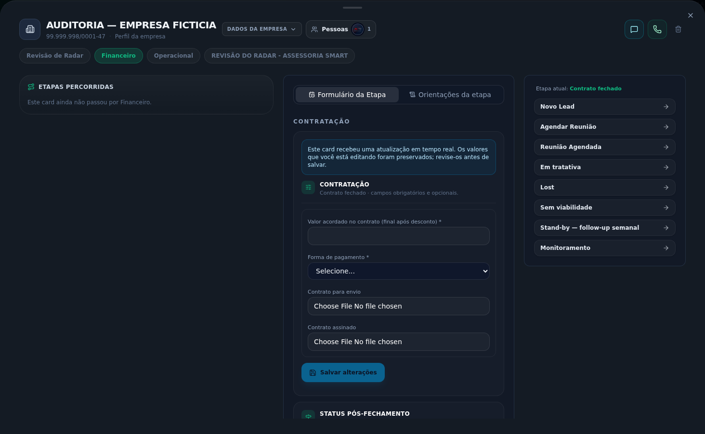
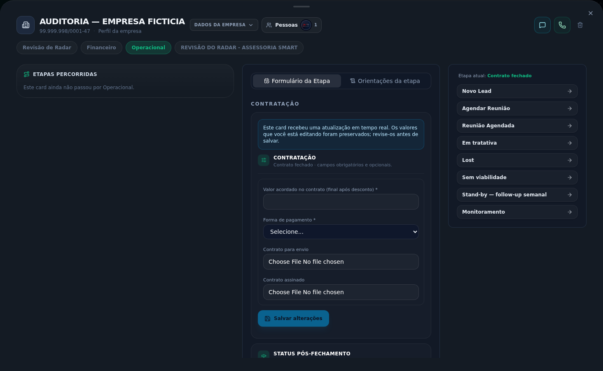

# Auditoria do fluxo do CRM — 21/10/2026

**Resultado: BLOQUEADO NO ENCAMINHAMENTO COMERCIAL → FINANCEIRO.**

O card de teste foi criado e percorreu as etapas comerciais com o **Admin**. Chegou a **Contrato fechado**, mas **não criou card no Financeiro**. Sem esse destino, o cenário também não chegou ao Operacional. Portanto, o fluxo completo **não está aprovado**: a auditoria identificou o bloqueio, mas não validou a execução financeira e operacional de ponta a ponta.

A causa observada no percurso Admin é objetiva: os movimentos são classificados como reposicionamento livre e **suprimem as automações**. Separadamente, a configuração dos encaminhamentos apresenta uma incompatibilidade com o executor legado, demonstrada por leitura da configuração e validação pura. Esse segundo achado não foi confundido com uma execução real falhada.

## 1. Escopo e identificação

| Item | Valor |
| --- | --- |
| Ambiente | https://staging.alpha-comex.com |
| Revisão auditada | `ab01802531516ada4211e6f3f59578d86b80fca3` |
| Deployment | `dpl_9a4CFm1rG9vAwBLDz7NFNzGpq4jQ` |
| Conta | Admin, ID `1`; login real, sem sessão ou papel fabricados |
| Empresa fictícia | **TESTE AUDITORIA CRM 21-10-2026 13H45** |
| Nome fantasia | AUDITORIA — EMPRESA FICTICIA |
| CNPJ sintético | `99.999.998/0001-47`, usado somente no cenário de teste |
| Empresa / card | `3066` / `cmvi5ztja000007l8livtiw1o` |
| Criação | 21/10/2026 às 10:45:23, horário de São Paulo |
| Última leitura do banco | 21/10/2026 às 11:05:18, horário de São Paulo |

O pedido inicial abrangia o fluxo completo. A orientação final foi: **“faça com admin mesmo, as validações eu vejo depois, eu quero ver se as automações de envio estão funcionando”**. Por isso, o foco foi o movimento administrativo e os encaminhamentos. Validações detalhadas de contratação, pagamento, assinatura, NF e usuário comum foram adiadas.

**Controle de versão:** a sessão começou no deployment identificado acima. Durante a auditoria/finalização, outro trabalho avançou o staging para `c2c4bc08` (ordem das anotações) e `a0b2e28e` (navegação dos alertas). A comparação de código confirmou que a lógica de movimentação, origem e execução/validação de automações usada nos achados principais permaneceu igual. As observações visuais descrevem a sessão capturada e não constituem aceite desses pacotes posteriores.

Nesta auditoria não foram alterados o código da aplicação, permissões, automações, esquema de banco ou dados de clientes reais. Não foram executados workers globais, replay de eventos, convites de reunião, cobranças ou emissão fiscal. O cenário fictício permanece disponível para inspeção; não foi apagado para preservar sua rastreabilidade. Credenciais, cookies e valores de ambiente ficaram fora dos artefatos.

## 2. O que foi executado

Percurso principal: **Novo Lead → Agendar Reunião → Reunião Agendada → Em tratativa → Contrato fechado → envio ao Financeiro não disparado**.

O card foi criado pela interface na primeira etapa de **Revisão de Radar**, o pipeline comercial ativo aplicável. Origem inicial: **Orgânico**. Radar pretendido: **Revisão de Radar Ilimitado**. A criação levou aproximadamente **2,833 s** até o fechamento do formulário.

A tabela usa o horário persistido no evento, convertido para São Paulo. A última coluna mede o intervalo da ação na interface até a confirmação/reabertura do detalhe; inclui trabalho de interface e não representa o tempo isolado do servidor.

| Movimento | Horário | Origem → destino | Controle usado | Persistência | Automações suprimidas | Confirmação visual |
| --- | --- | --- | --- | --- | --- | --- |
| 1 | 10:51:25 | Novo Lead → Agendar Reunião | painel lateral do card | Gravado, v1 | Sim | 2.866 s |
| 2 | 10:54:57 | Agendar Reunião → Reunião Agendada | painel lateral do card | Gravado, v2 | Sim | 12.073 s |
| 3 | 10:55:46 | Reunião Agendada → Em tratativa | painel lateral do card | Gravado, v3 | Sim | 2.260 s |
| 4 | 10:56:54 | Em tratativa → Contrato fechado | painel lateral do card | Gravado, v4 | Sim | 4.278 s |
| 5 | 11:02:03 | Contrato fechado → Em tratativa | arrastar no Kanban | Gravado, v5 | Sim | 4.562 s |
| 6 | 11:03:56 | Em tratativa → Contrato fechado | painel lateral do card | Gravado, v6 | Sim | 2.756 s |

Os movimentos 1–4 são o percurso principal. Os movimentos 5–6 são um teste adicional de retorno pelo Kanban e restauração da posição final; não representam uma segunda contratação nem um encaminhamento.

**Estado final confirmado no banco:** Contrato fechado, `ATIVO`, versão **6**, `concluidoEm = null`; **seis eventos** de movimentação, **zero execuções de automação**, **zero vínculos** e **um único card** da empresa fictícia. Não existe card Financeiro ou Operacional para esse cenário. Estar na coluna final, portanto, não equivale a uma conclusão financeira nem comprova encaminhamento.

### Comprovação na interface

A aba Financeiro informou **“Este card ainda não passou por Financeiro”**. A aba Operacional informou o mesmo para seu pipeline.



*Captura do cenário fictício: Financeiro selecionado, sem passagem registrada; formulário central ainda em Contrato fechado.*



*Não existe card operacional no cenário. A captura não é uma validação das etapas operacionais.*

## 3. Achados prioritários

### CRM-01 — Alta: Admin avança a coluna, mas não dispara o envio

**Evidência:** reprodução real na interface e confirmação no banco.

**Reprodução:** entrar como Admin; criar um card em Novo Lead; avançar pelo painel lateral até Contrato fechado. O mesmo modo administrativo também foi exercido pelo Kanban.

**Esperado para o objetivo solicitado:** conseguir testar o encaminhamento ao Financeiro usando Admin. **Observado:** os seis eventos registram `movimentoLivre.tipo = ADMIN` e `automacoesSuprimidas = true`. Nenhuma execução ou card de destino é criado.

**Causa:** o modo de movimento livre retorna sem transição de negócio e exclui o enfileiramento de automações/cadências. O consumidor de eventos também ignora a marca de supressão. É uma escolha presente no código; isso não significa que atenda à expectativa atual do usuário. Neste percurso, constitui o bloqueio funcional comprovado.

**Impacto:** um administrador pode deixar o card visualmente na etapa final sem encaminhar o trabalho ao setor seguinte.

**Mudança recomendada:** separar claramente **“Reposicionar card”** de **“Avançar e encaminhar”**, ou oferecer uma ação explícita de envio para Admin. Manter sua liberdade de movimentação sem fabricar aprovação de pagamento/assinatura/NF. O envio deve registrar autoria e impedir duplicação.

**Referências técnicas:** `src/lib/bpm/transicao-command.ts:425`, `:1072`, `:1139`; `src/lib/bpm/automacoes/eventos.ts:96`.

### CRM-02 — Alta: os encaminhamentos cadastrados não são compatíveis com o executor que os recebe

**Evidência:** configuração real somente leitura + execução da função pura de validação. **Não foi uma execução real falhada do encaminhamento**, pois Admin não o enfileirou.

As **37 automações ativas** consultadas não possuem versão central `ATIVA`. Isso, isoladamente, não significa que todas estejam quebradas: ações suportadas pelo motor legado podem continuar válidas. O problema confirmado é que **três ações `CRIAR_CARD_OUTRO_PIPELINE`** usam esse caminho legado, cujo validador/executor não suporta essa ação.

| Automação | Gatilho e destino | IDs de rota | Versão central ativa | Validação pelo legado |
| --- | --- | --- | --- | --- |
| Fechado — criar card no Financeiro | Contrato fechado → Financeiro / Novo Contrato | Corretos e ativos | Ausente | Rejeitada |
| Concluido — criar card no Operacional | Financeiro / Concluido → Operacional / Boas vindas | Corretos e ativos | Ausente | Rejeitada |
| Assessoria Smart — espelhar na Revisão | Enviar para REVISÃO → Operacional / Revisão | Corretos e ativos | Ausente | Rejeitada |

O terceiro caso é uma observação adicional da configuração; o percurso Smart não foi executado. O destino Revisão, diferente da primeira etapa operacional, está configurado dessa forma e não foi classificado como erro por isso.

O validador legado aceita ações específicas e encaminha os demais tipos para o schema de oportunidade. Os parâmetros de envio (`pipelineId`, `etapaId`, vínculo e deduplicação) são rejeitados, com ausência de `servicoAlvoId`, `condicao` e `acao`. O motor central suporta a ação de envio, mas só processa suas versões/execuções versionadas.

**Impacto:** remover somente a supressão do Admin não basta para aprovar os encaminhamentos. Existe uma segunda incompatibilidade a resolver.

**Mudança recomendada:** publicar os encaminhamentos em um caminho de execução compatível, com versão ativa verificável, e impedir que o editor aceite uma ação que o executor selecionado não consegue processar. Retestar os dois envios e a prevenção de duplicatas antes de considerar o fluxo aprovado.

**Referências:** `automacoes/fila.ts:58`, `automacoes/executor.ts:364`, `automacoes/schemas.ts:202`, `automacoes/central-runtime.ts:724`. Os caminhos são relativos a `src/lib/bpm/`.

### CRM-03 — Média: a origem do Novo Lead não é herdada no fechamento

**Evidência:** interface e leitura dos campos do card.

**Reprodução:** criar com Canal de origem = Orgânico e abrir Dados para o Financeiro em Contrato fechado. **Observado:** o primeiro campo conserva “Orgânico”, mas **Origem do cliente** aparece vazio. São campos CARD distintos, sem mapeamento entre eles e sem valor global comum.

O valor original **não foi apagado**. O defeito é a ausência de herança/preenchimento consistente entre os formulários. O cenário ainda não possui card financeiro; portanto, não foi demonstrada perda de origem em um destino financeiro criado.

**Impacto:** preenchimento repetido, divergência de origem e risco para relatórios/atribuição comercial.

**Mudança recomendada:** definir uma origem canônica compartilhada ou um mapeamento explícito entre as etapas, preservando escolhas posteriores autorizadas e o vínculo de parceiro quando aplicável.

### CRM-04 — Média: falta um diagnóstico claro do encaminhamento na tela

O card muda de etapa e mantém os formulários, mas não explica de forma explícita **“envio ao Financeiro não disparado: movimento administrativo”**. A ausência só fica evidente pela consulta à outra aba e pela leitura técnica.

**Sugestão:** mostrar um estado próprio do envio — não disparado, aguardando, enviado ou falhou — com motivo, destino e horário. Um controle de repetição deve atuar somente no encaminhamento específico e preservar a idempotência. A coluna final e o status do envio precisam ser distinguíveis.

## 4. Outras observações e melhorias de experiência

| ID / prioridade | Observação real | Melhoria proposta |
| --- | --- | --- |
| CRM-05 / baixa | Aviso de atualização em tempo real surgiu antes de editar os formulários e repetiu-se em vários blocos. | Exibir aviso de conflito somente quando houver edição local afetada; consolidar mensagens. |
| CRM-06 / baixa | Abas Financeiro/Operacional mudam o histórico à esquerda, enquanto o formulário central continua comercial. | Identificar essas abas como histórico de passagem ou sinalizar claramente qual card/pipeline está sendo editado. |
| CRM-07 / média | Confirmação visual variou de 2,260 a 12,073 s, incluindo atualização/reabertura. | Medir cada etapa da requisição e manter feedback e trava de repetição. Não atribuir o pico ao backend sem medição específica; houve timeout na conexão usada pela auditoria. |
| CRM-08 / baixa, incidental | O componente global de voz do Bibble retornou 147 respostas 503 na janela observada. Nenhum erro JavaScript não tratado foi capturado na página. | Reduzir polling enquanto o serviço estiver indisponível, usar backoff e indicar o estado da função. Não foi comprovada relação causal com o bloqueio do CRM. |
| CRM-09 / baixa, transitória | Aproximadamente 300 ms após o drop, o card já estava em Em tratativa e o contador da coluna ainda era 0. | Atualizar contadores junto da prévia otimista. Não foi constatado erro permanente de total. |

Também convém reduzir a repetição de títulos como “CONTRATAÇÃO” e “DADOS PARA O FINANCEIRO” e considerar manter o detalhe aberto ao avançar, para facilitar preenchimento sequencial. Essas são sugestões de UX, não provas de falha de persistência.

## 5. O que funcionou e o que não foi validado

| Verificação | Resultado / limite |
| --- | --- |
| Login real do Admin no staging | Aprovado. Nenhuma sessão ou permissão foi fabricada. |
| Criação na primeira etapa comercial | Aprovada; um cenário fictício identificado e persistido. |
| Movimento pelo painel lateral | Aprovado como reposicionamento administrativo, sem validar negócio. |
| Movimento pelo Kanban e retorno | Aprovado, com persistência e restauração da etapa final. |
| Histórico e autoria | Seis movimentos persistidos com Admin; etapas percorridas visíveis. |
| Anotação | Texto salvo e reapresentado no Histórico; registro confirmado no banco. |
| Vendedor responsável | Exibiu o nome “ADM”, não o ID `1`, no formulário de fechamento. |
| Seletor de origem | Fundo escuro e texto claro, `color-scheme: dark`; parceiro aparece ao escolher indicação. Seleção/persistência de um parceiro não foi exercida. |
| Procedimento ausente | Aviso amigável “Nenhum procedimento para esta etapa”; sem botão de erro/tentar novamente. |
| Envio Comercial → Financeiro com Admin | Bloqueado: destino não criado, nenhuma execução enfileirada. |
| Envio Financeiro → Operacional em runtime | Não executado: o cenário não alcançou o Financeiro. Configuração/validador foram auditados separadamente. |
| Prevenção de duplicatas dos envios | Não comprovada em execução; não houve primeiro envio. Flags configuradas foram apenas conferidas. |
| Assinatura, pagamento, NF, Meet e execução operacional | Não executados; sem documentos/lançamentos reais e sem convites externos. |
| Validações de usuário comum, tarefas/alertas e upload | Fora do foco final ou não exercidos; não recebem aprovação por inferência dos testes locais. |

## 6. Ordem recomendada das mudanças

1. **P1 — Resolver a semântica do Admin:** preservar reposicionamento livre e criar um caminho inequívoco para avançar/disparar encaminhamentos quando essa for a intenção.
2. **P1 — Compatibilizar as automações de envio:** versão/executor corretos, validação de configuração e diagnóstico de falha. Os IDs de destino já estão corretos; renomear etapas não resolve a causa.
3. **P1 — Repetir o teste real:** criar exatamente um destino no Financeiro e outro no Operacional, verificar vínculos, localização na origem, acesso, dados herdados e repetição sem duplicatas. Não declarar o fluxo completo aprovado antes disso.
4. **P2 — Unificar a origem e melhorar o acompanhamento:** reduzir preenchimento repetido e tornar o status do envio visível.
5. **P3 — Refinar feedback/UX:** mensagens de conflito, contexto das abas, contadores, tempos de atualização e polling dos serviços indisponíveis.

Nenhuma dessas mudanças foi implementada nesta auditoria. O relatório é o diagnóstico e a proposta de próximos passos.

## 7. Verificações técnicas e evidências

- `npm run lint`: aprovado, zero erros; 1.193 avisos existentes.
- `npm run typecheck`: aprovado.
- `npm test -- --maxWorkers=2`: aprovado, **678 arquivos e 5.147 testes**, quatro skipped e um todo.
- A auditoria não alterou a fonte da aplicação; build de aplicação não foi repetida para produzir o relatório.
- Validação pura dos três encaminhamentos: todos rejeitados pelo schema legado. O reprodutor não conecta banco nem executa worker.

Esses gates locais aprovados **não substituem** o resultado do fluxo real, que ficou bloqueado.

Artefatos versionáveis:

- [Evidências estruturadas em JSON](auditoria-fluxo-crm-2026-10-21.json): movimentos, eventos, configuração, contagens finais, cobertura e gates; sem credenciais.
- [Reprodutor puro da incompatibilidade](evidencias/crm-2026-10-21/validacao-parametros.mjs).
- Capturas do próprio cenário fictício incluídas acima. Logs brutos de navegador, ambiente e conexão permaneceram privados fora do Git.

Para repetir somente a validação pura, na raiz do projeto:

```sh
node --import tsx docs/reports/evidencias/crm-2026-10-21/validacao-parametros.mjs
```

**Parecer:** o teste comprovou que, na versão auditada e no percurso solicitado com Admin, o encaminhamento automático ao Financeiro não aconteceu. A etapa seguinte até o Operacional permaneceu não executada no cenário real. Há evidência suficiente para priorizar as correções, mas não para aprovar a cadeia completa.
