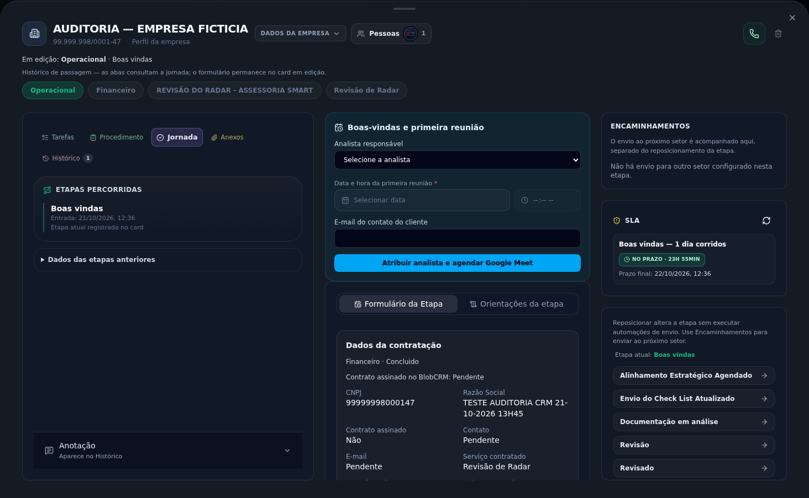

# Validação das correções do CRM — 21/10/2026

**Resultado: APPROVED — cadeia de encaminhamentos com Admin no staging.** O cenário fictício chegou do Comercial ao Financeiro e à entrada do Operacional. Foram confirmados **três cards, duas execuções SUCESSO e três vínculos**, sem duplicação ao repetir exatamente as requisições de envio. Este resultado não aprova regras financeiras nem a execução completa do trabalho operacional.

## Revisão e ambiente

| Item | Evidência |
| --- | --- |
| Commit de runtime | `027881435e8e296c89519604a37790bd554a3b3f` |
| Deployment | `dpl_3XqC9y8Z8vuz4oJzYUKf2KwpQxKD`, READY, ambiente `staging` |
| Endereço | https://staging.alpha-comex.com; verificação de banco/alias HTTP 200 |
| Autenticação | Login real de Admin ID 1; sem papel ou sessão fabricados |
| Cenário | Empresa fictícia ID 3066, criada na auditoria anterior |
| Snapshot final | 21/10/2026 15:46:46.202 UTC |
| Observação do navegador | 15:24:57.288–15:42:00 UTC; zero erros JavaScript e zero erros HTTP fora do serviço de voz |
| Produção | Não publicada nesta entrega |

A [auditoria original](auditoria-fluxo-crm-2026-10-21.md), baseada inicialmente em `ab018025`, permanece preservada, inclusive seu resultado bloqueado e PDF. Este documento registra o reteste posterior às correções. O [JSON sanitizado](validacao-correcoes-crm-2026-10-21.json) contém IDs, contagens, estados e medidas que sustentam as conclusões.

## Percurso e persistência

1. Reposicionamento livre pelo detalhe com clique repetido e pelo Kanban: somente dois novos eventos, versão comercial 6→8, **zero envios**. Contadores filtrados mudaram de 1/0 para 0/1 na amostra cerca de 300 ms após o drop (684 ms desde o início do arraste).
2. Comercial em Contrato fechado → ação explícita de envio → um Financeiro em Novo Contrato, uma execução SUCESSO e um vínculo; origem comercial passou à versão 9. A interface explicou a exceção administrativa.
3. Financeiro percorreu seus cinco avanços administrativos, mantendo o detalhe aberto e sem avisos falsos de conflito.
4. Financeiro em Concluido → ação explícita de envio → um Operacional em Boas vindas. Total: duas execuções SUCESSO e vínculos Comercial→Financeiro, Financeiro→Operacional e Comercial→Operacional.
5. O Operacional foi aberto pela interface e aguardado até ficar pronto: controles das etapas visíveis, contexto **“Formulário em edição: Operacional · Boas vindas”** e histórico de passagem identificado.

| Card | ID | Etapa final | Status / versão |
| --- | --- | --- | --- |
| Revisão de Radar | `cmvi5ztja000007l8livtiw1o` | Contrato fechado | ATIVO / 9 |
| Financeiro | `cmvi9qcjb000608jpdywhf639` | Concluido | ATIVO / 6 |
| Operacional | `cmvi9yezf000508jtgmijtabd` | Boas vindas | ATIVO / 0 |

**Idempotência real:** a repetição da requisição capturada de cada envio retornou HTTP 200 com `existente=true`. A leitura SQL independente confirmou a preservação de cards, vínculos, execuções, versões, históricos e eventos. No segundo envio, todas as **13 comparações profundas** passaram, incluindo linhas completas, campos, estados de aprovação e contagens de artefatos. Nenhum novo registro de envio ou incremento de versão foi observado nesses replays. Uma leitura independente posterior ao fechamento do navegador, às 15:46:46.202 UTC, reconfirmou os mesmos estados negociais; metadados de primeira visualização não são confundidos com um novo encaminhamento.

**Dados herdados e autoria:** Orgânico reapareceu no formulário de fechamento e permaneceu nos três cards. No Comercial, o valor persistido continua no campo original Canal de origem; Financeiro e Operacional possuem Origem do cliente. O fallback de leitura do fechamento não prova gravação de outra linha. Dois históricos `ENCAMINHAMENTO_ADMIN_SOLICITADO` e dois eventos de criação de destino identificam o usuário 1. O registro auxiliar legado `CARD_CRIADO_POR_AUTOMACAO` pode ter usuário nulo; não se atribui toda a trilha a um ator humano.

**Preservação financeira:** os três cards seguem ATIVO, com `concluidoEm` e `statusPosFechamento` nulos. Não foram criados contratos, anexos, cadências, execuções de cadência, linhas de aprovação ou flags de assinatura, pagamento e NF. A coluna Concluido do Financeiro representa o reposicionamento observado; não comprova pagamento ou conclusão financeira de negócio.

## Rastreabilidade dos achados

| Achado | Resultado e alcance da evidência |
| --- | --- |
| CRM-01 | Reposicionamento livre separado; dois envios explícitos criaram os destinos sem fabricar conclusão financeira. |
| CRM-02 | Definições existentes executadas pelo helper compatível; Smart e demais variações somente em testes locais. |
| CRM-03 | Orgânico reapresentado no fechamento e persistido nos dois destinos; parceiro/customização/limpeza/divergência cobertos localmente. |
| CRM-04 | UI diferencia Não enviado/Enviado, explica exceção e abre destino; falhas/retentativas específicas exercitadas localmente. |
| CRM-05 | Zero avisos falsos nos movimentos observados; conflitos reais/rascunhos cobertos localmente. |
| CRM-06 | Contexto em edição Operacional · Boas vindas e indicação de histórico de passagem confirmados ao abrir destino. |
| CRM-07 | Modal aberto e fases medidas separadamente; não há garantia numérica de melhora de latência. |
| CRM-08 | Respostas 503 espaçadas em cerca de 60/120/240/300 segundos; serviço de voz não voltou a ficar disponível. |
| CRM-09 | Contagens filtradas 1/0→0/1 na amostra aproximadamente 300 ms após o drop; rollback e filtros também cobertos localmente. |
| UX | Cinco avanços financeiros mantiveram detalhe aberto; centro e histórico distinguíveis; títulos/composição cobertos localmente. |

CRM-02 não significa que todas as definições legadas estavam quebradas. A correção usa o helper compatível nos caminhos central, legado e explícito, preservando as configurações existentes; o reteste remoto exercitou os dois encaminhamentos deste cenário.

## Tempos observados e voz

| Movimento financeiro | Confirmação UI (ms) | Salvamento (ms) | Requisição (ms) | Atualização (ms) |
| --- | ---: | ---: | ---: | ---: |
| Novo Contrato → Elaboração de Contrato | 2370 | 1 | 776 | 1219 |
| Elaboração de Contrato → Formalização | 2853 | 1 | 1336 | 1077 |
| Formalização → Confirmação de Pagamento | 2856 | 1 | 723 | 1653 |
| Confirmação de Pagamento → Emissão de Nota Fiscal | 10395 | 1 | 1345 | 8617 |
| Emissão de Nota Fiscal → Concluido | 7372 | 1 | 909 | 6276 |

Os envios Comercial→Financeiro e Financeiro→Operacional levaram 8.463 ms e 11.175 ms até a confirmação visual. As medidas incluem atualização/reconciliação e captura da interface; não isolam o backend, não estabelecem causalidade e não demonstram melhora percentual. A fase de atualização chegou a 8.617 ms, portanto ainda existe latência perceptível mesmo com o modal mantido aberto e feedback correto.

A voz respondeu **503** às 15:25:02.207, 15:26:02.428, 15:28:02.644, 15:32:02.830 e 15:37:03.232 UTC: intervalos de **60,221 / 120,216 / 240,186 / 300,402 segundos**. O backoff foi confirmado no ambiente real; o serviço de voz continuou indisponível e sua recuperação não foi demonstrada.

## Gates e limites

- Suíte final: exit 0, **686 arquivos e 5.278 testes aprovados**, quatro skipped e um todo. A primeira rodada teve cinco arquivos/sete testes com falha; seu log foi preservado, os contratos de teste/fixture afetados foram corrigidos e a suíte completa foi repetida com sucesso.
- Lint e typecheck: exit 0; lint manteve 1.193 avisos existentes. Build: exit 0 em 150,62 s; smoke do build aprovado. Runtime idêntico ao fingerprint do build aprovado; nenhuma fonte mudou após o commit publicado.
- Revisões locais Forge, Anubis, Lens e Probe aprovadas. Testes automatizados de banco usaram SQLite privado com sentinela local e token vazio.
- Usuário comum, parceiro, origem personalizada, Smart, falhas, configuração alterada, concorrência, isolamento entre empresas e retentativa específica foram cobertos localmente; não constituem jornadas remotas deste reteste Admin/Orgânico.
- Não foram executados cobrança, assinatura, emissão fiscal, convites Meet, worker global ou trabalho operacional após a entrada em Boas vindas. Não houve migração ou alteração em massa do banco.

O JSON versionado foi construído por lista explícita de campos do cenário sintético. DOM bruto, opções de colaboradores, requisições/respostas brutas, cookies, credenciais e valores de ambiente ficaram fora dos artefatos. Somente a captura final revisada do cenário fictício acompanha este relatório. Evidências privadas de navegador e SQL permanecem separadas.
